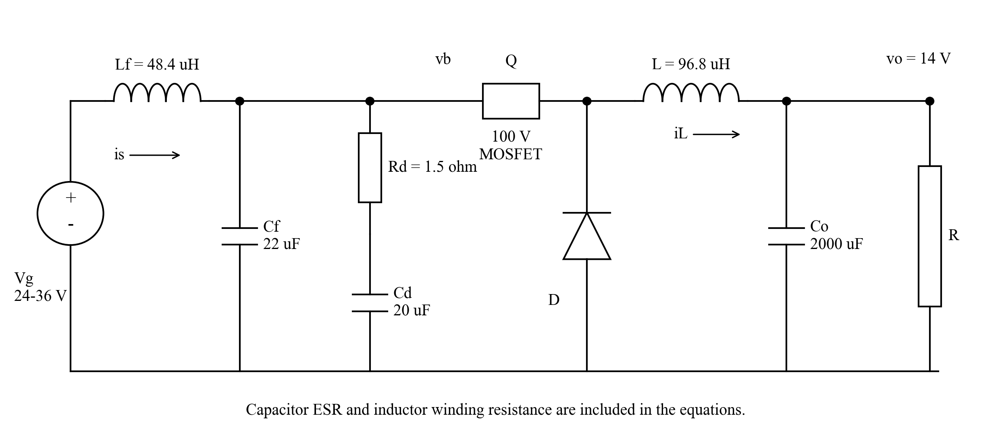
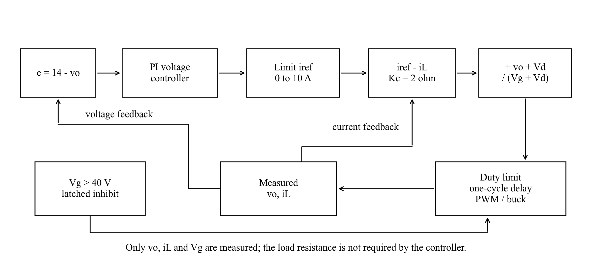
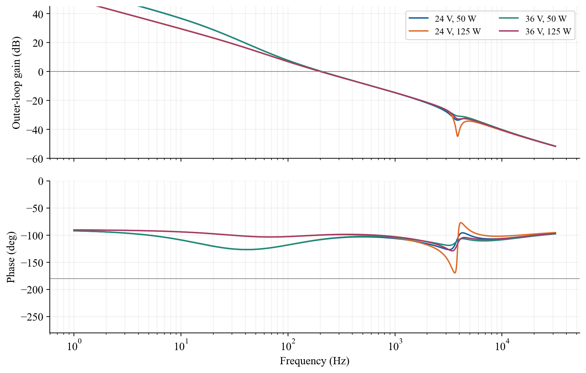
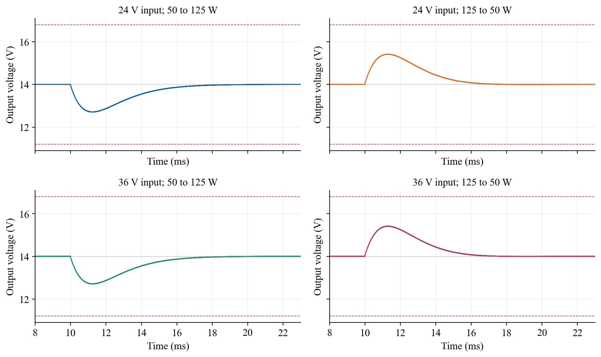
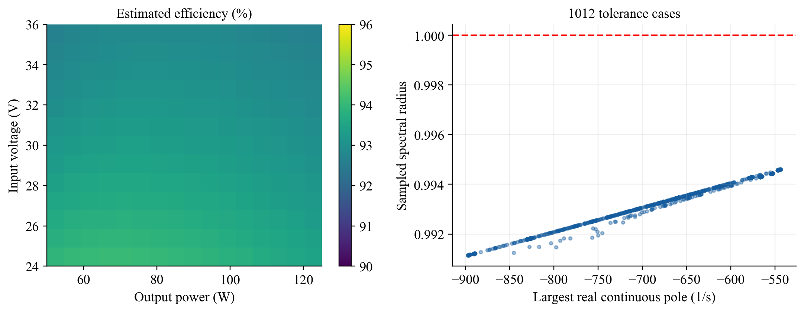
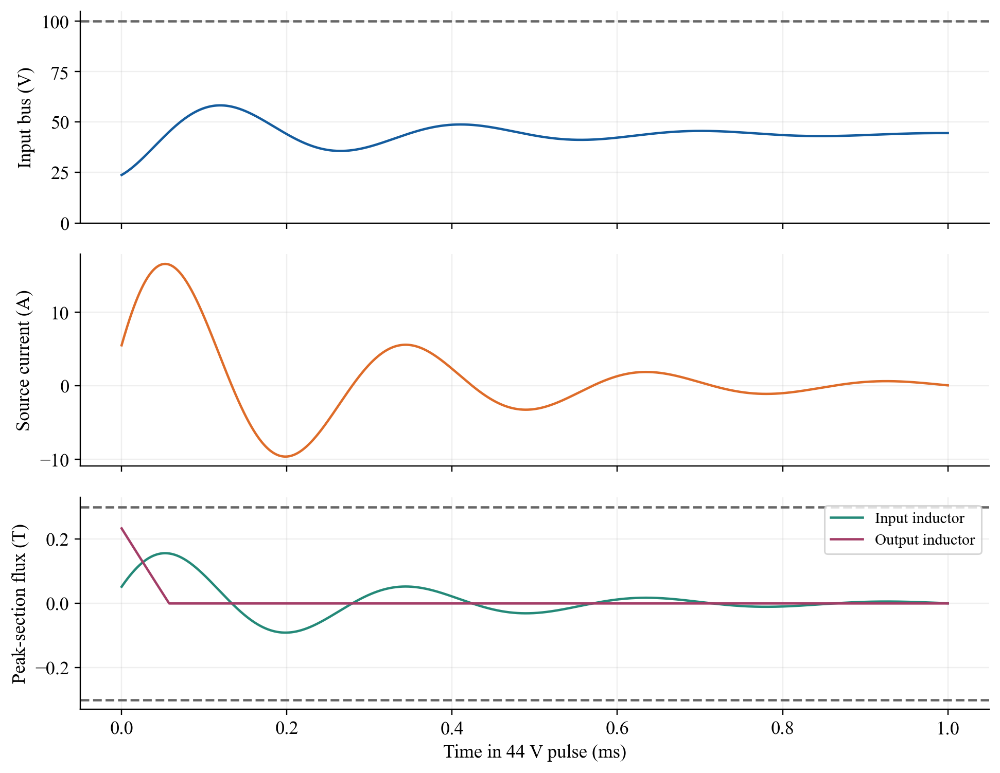
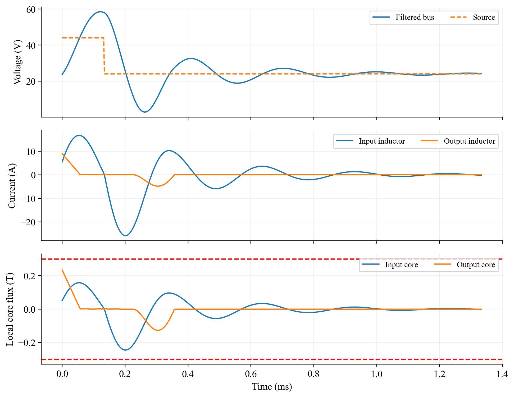
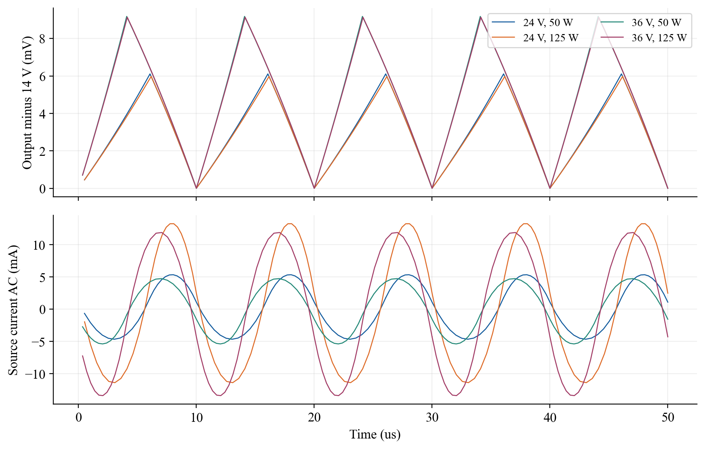

# MIT 6.622: Complete Step-by-Step README

## عنوان و توضیح فارسی پروژه

**عنوان:** طراحی و شبیه‌سازی مبدل کاهندهٔ ۱۴ ولت با کنترل دوحلقه‌ای جریان و ولتاژ

**توضیحات:** طراحی مبدل کاهندهٔ ۱۴ ولت و ۵۰ تا ۱۲۵ وات با ورودی ۲۴ تا ۳۶ ولت
و کنترل دوحلقه‌ای جریان و ولتاژ؛ شامل کد متلب، روابط گام‌به‌گام و بررسی
پایداری، ریپل، بازده، پاسخ گذرا و تحمل پالس ورودی ۴۴ ولت.

## English project title

**Design and Simulation of a 14 V Buck Converter with Cascaded Current and Voltage Control**

Documentation prepared on **9 November 2026**, using the delivered design and its
existing numerical records. This document expands the README; it does not change
the converter parameters, the MATLAB algorithm, or the reported results.

The explanation, derivations, and code commentary below are in English. Equations
are editable LaTeX rather than screenshots. Each major calculation is connected
to the relevant MATLAB implementation, and Appendix A contains the entire
unchanged MATLAB function file.

### Execution status

The supplied MATLAB file was syntax-checked, but **was not executed in MATLAB or
Octave** in the authoring environment. The numerical tables and scientific
figures supplied with the project were generated by the included independent
Python/NumPy/SciPy implementation of the same model equations. They are
computational results, not measurements from hardware.

Writing this expanded README does not constitute an additional experiment or a
new MATLAB execution. The finite parameter sweeps described here do not prove
every possible continuous combination of parameters.

### How to use the files

1. Extract the documented project archive.
2. Keep the directory structure so relative figure and data links work.
3. Open `matlab/buck622.m` in MATLAB.
4. Set the current folder to `matlab`.
5. Run the following public entry point.

```matlab
results = buck622;
```

To select a results directory and suppress graphics:

```matlab
results = buck622('my_results', false);
```

Only base MATLAB functions are used; Simulink and additional toolboxes are not
required by the source. The code generates CSV tables, a MAT-file, and, when
requested, four PNG figures.

The named helper functions shown in the chapters are **local functions in
`buck622.m`**. They explain what happens inside the public entry point; they are
not separate functions that MATLAB can necessarily call from the Command Window.
Run the complete file, or inspect a helper while debugging the main function.
Copying an isolated helper call into the Command Window does not make that local
function public.

The Markdown file contains the report text, formulas, relevant code, and complete
source. Figures and original numerical records are supplied in the archive.
The earlier PDF report is `MIT_6_622_Buck_Converter_Worked_Solution.pdf`.

## Contents

- [Step 1: Translate the assignment into numerical requirements](#step-1)

- [Step 2: Identify the circuit, signals, states, and parameter names](#step-2)

- [Step 3: Derive the two switching-position equations](#step-3)

- [Step 4: Include capacitor ESR in the node equations](#step-4)

- [Step 5: Average the correct vector fields](#step-5)

- [Step 6: Solve the nonideal steady operating point](#step-6)

- [Step 7: Size the output inductor and verify CCM](#step-7)

- [Step 8: Design both custom magnetic components](#step-8)

- [Step 9: Design the output capacitor bank](#step-9)

- [Step 10: Design the input capacitor, filter, and damping branch](#step-10)

- [Step 11: Write the cascaded controller and anti-windup law](#step-11)

- [Step 12: Explain the selected controller gains](#step-12)

- [Step 13: Linearize the complete converter](#step-13)

- [Step 14: Include the digital duty delay](#step-14)

- [Step 15: Calculate the outer-loop Bode response and margins](#step-15)

- [Step 16: Simulate the actual ON and OFF intervals](#step-16)

- [Step 17: Evaluate load steps and settling time](#step-17)

- [Step 18: Calculate semiconductor losses, efficiency, and temperature](#step-18)

- [Step 19: Run the line/load and component-tolerance sweeps](#step-19)

- [Step 20: Model the held 44 V input pulse](#step-20)

- [Step 21: Check the return edge and MOSFET body diode](#step-21)

- [Step 22: Derive and compute the harmonic ripple model](#step-22)

- [Step 23: Run the complete workflow and interpret its files](#step-23)

- [Step 24: Read the numerical results against the specifications](#step-24)

- [Step 25: Understand assumptions, limitations, and safe edits](#step-25)

- [Appendix A: complete unchanged MATLAB source](#appendix-a)
- [Appendix B: function and parameter reference](#appendix-b)
- [References and source documents](#references)

<a id="step-1"></a>

## Step 1. Translate the assignment into numerical requirements

The assignment requires a buck converter supplying a **resistive** load. Start by
turning each requirement into a numerical test. Normal switching ripple is a
steady periodic quantity; it is not the same as the larger voltage excursion
permitted during a load step.

| Quantity | Requirement | How it is assessed |
| --- | --- | --- |
| Normal source voltage | 24-36 V | Operating corners and an interior line/load grid |
| Exceptional source event | 44 V for up to 1 ms | Inhibited-switch surge and pulse-return models |
| Output voltage | 14 V ±3% in steady state | Mean periodic output voltage |
| Output power | 50-125 W at nominal voltage | Resistance values derived below |
| Load-step output bounds | 14 V ±20% | Both directions of the maximum resistance step |
| Output switching ripple | ≤100 mV peak-to-peak | Switched and harmonic models |
| Ideal-source current ripple | ≤50 mA peak-to-peak | Source-side current after input filtering |
| Efficiency | ≥90% | Explicit power-loss estimate |
| Ambient temperature | -20 to +50 °C | 50 °C thermal sizing and declared cold-parameter stress |

### 1.1 Derive resistance and current from power

For a resistor, Ohm's law gives $I_o=V_o/R$. Substitution into $P_o=V_oI_o$ gives

$$
P_o=\frac{V_o^2}{R},
\qquad
R=\frac{V_o^2}{P_o},
\qquad
I_o=\frac{P_o}{V_o}.
$$

At $V_o=14$ V:

$$
R_{50}=\frac{14^2}{50}=3.920\ \Omega,
\qquad
R_{125}=\frac{14^2}{125}=1.568\ \Omega.
$$

The corresponding currents are 3.571 A and 8.929 A. The transient simulation
switches **resistance**, keeping the physical load resistive even when the output
temporarily departs from 14 V. It does not impose a constant-power output load.

### 1.2 Derive the voltage bounds

$$
V_{o,\mathrm{static}}\in
[14(1-0.03),14(1+0.03)]=[13.58,14.42]\ \mathrm V,
$$

$$
V_{o,\mathrm{step}}\in
[14(1-0.20),14(1+0.20)]=[11.2,16.8]\ \mathrm V.
$$

The assignment permits switching to stop during the 44 V event. Consequently,
normal voltage regulation during that exceptional event is not claimed.

```matlab
corners = [24 50; 24 125; 36 50; 36 125];
R_light = 14^2/50;
R_heavy = 14^2/125;
V_static_bounds = 14*[0.97 1.03];
V_step_bounds = 14*[0.80 1.20];
```

<a id="step-2"></a>

## Step 2. Identify the circuit, signals, states, and parameter names



The ideal source feeds the custom input inductor $L_f$. At the filtered bus,
$C_f$ supplies the rapidly varying switch current. A separate series $R_d-C_d$
branch damps the input-filter resonance. The MOSFET, freewheel diode, output
inductor $L$, and capacitor bank $C_o$ form the asynchronous buck stage.

The freewheel diode anode is grounded and its cathode is at the switch node.
Both junctions of the selected dual Schottky package are used in parallel.

### 2.1 State definitions

$$
x_p=
\begin{bmatrix}
i_f & v_{Cf} & v_{Cd} & i_L & v_{Co}
\end{bmatrix}^{T}.
$$

The capacitor states are **ideal capacitance voltages**, not external terminal
voltages. The full continuous controller state appends the integrator state $z$:

$$
x=\begin{bmatrix}x_p^T&z\end{bmatrix}^T.
$$

| Quantity | Meaning | MATLAB representation |
| --- | --- | --- |
| Vg | Ideal-source voltage, upstream of the input filter | vg |
| vb | Filtered input-bus terminal voltage | vb from nodes |
| vo | Load terminal voltage | vo from nodes |
| if = is | Input-inductor current; current at the ideal source | x(1) |
| vCf | Ideal voltage of the main input capacitor | x(2) |
| vCd | Ideal voltage of the damping capacitor | x(3) |
| iL | Output-inductor current | x(4) |
| vCo | Ideal voltage of the output capacitor | x(5) |
| z | Voltage-PI integral contribution, in amperes | x(6) |
| q | Normal switch-position indicator: ON = 1, OFF = 0 | q in phase_rhs |
| D | Average duty ratio or duty held for one switching cycle | d / dhold |

### 2.2 Keep similarly named resistances separate

The following mapping is used consistently in this README. In particular,
`p.rf` is input-capacitor ESR, whereas `p.rlf` is input-winding resistance.
Confusing these changes the filter dynamics and the loss estimate.

| Mathematical symbol | Physical quantity | Code field | Value |
| --- | --- | --- | --- |
| $r_L$ | Output-winding resistance | p.rl | 0.020 Ω |
| $r_{L_f}$ | Input-winding resistance | p.rlf | 0.043 Ω |
| $r_{C_f}$ | Main input-capacitor bank ESR | p.rf | 0.005 Ω |
| $r_o$ | Output-capacitor bank ESR | p.ro | 0.010 Ω |
| $R_d$ | Damping-branch resistance | p.rd | 1.5 Ω |
| $R_Q$ | Hot MOSFET on-resistance allowance | p.ron | 0.014 Ω |

### 2.3 Chosen values

The switching period is $T_s=1/f_s=10\ \mu$s. The parameters below define the
delivered design; they are not the result of an optimization performed while
writing this README.

**Implementation in the supplied file: parameters.**

```matlab
function p=parameters()
p.V=14; p.fs=1e5; p.L=96.8e-6; p.Lf=48.4e-6;
p.C=2e-3; p.Cf=22e-6; p.Cd=20e-6;
p.ro=.010; p.rf=.005; p.rd=1.5;
p.rl=.020; p.rlf=.043; p.ron=.014; p.vd=1.0;
p.kc=2; p.kp=2.5; p.ki=1250; p.aw=2000;
p.ilim=10; p.dmax=.9; p.Ta=50;
p.tr=36e-9; p.tf=21e-9; p.Qg=100e-9; p.Vgate=10;
p.Coss=1500e-12; p.Rhs=5.3; p.Rcs=1.0;
p.Rjc_mos=1.0; p.Rjc_diode=.9;
p.N=22; p.Nf=32; p.AL=200e-9; p.ALf=48.4e-6/32^2;
p.Ae=198e-6; p.Amin=168e-6; p.Aw=112e-6; p.Vcore_cm3=13.9;
p.lesl_in=5e-9; p.lesl_out=10e-9; p.lesl_d=20e-9;
end
```

All stored electrical values use SI units, except `p.Vcore_cm3`, which is
deliberately in cm³ because the assignment's core-loss fit specifies that unit.
Inductance factors `p.AL` and `p.ALf` are in H/turn².

<a id="step-3"></a>

## Step 3. Derive the two switching-position equations

### 3.1 Start with the component laws

An ideal inductor follows $v_L=L\,di_L/dt$. An ideal capacitor follows
$i_C=C\,dv_C/dt$. These relations, together with Kirchhoff's voltage and current
laws, generate the complete physical model.

For $q=1$, the MOSFET is ON. The switch node is approximately
$v_b-R_Qi_L$. The output inductor sees this voltage minus the load terminal
voltage and winding drop:

$$
L\frac{di_L}{dt}=v_b-v_o-(r_L+R_Q)i_L
\qquad(q=1).
$$

For $q=0$ and positive freewheel current, the diode clamps the switch node near
$-V_F$. Therefore,

$$
L\frac{di_L}{dt}=-V_F-v_o-r_Li_L
\qquad(q=0,\ i_L>0).
$$

Writing both normal-conduction positions in one expression gives

$$
L\frac{di_L}{dt}
=q(v_b-R_Qi_L)-(1-q)V_F-r_Li_L-v_o.
$$

This compact expression assumes the specified normal conduction path exists.
It is not valid without modification after a diode current reaches zero or when
the MOSFET body diode becomes the active path. Steps 20-21 implement those modes.

### 3.2 First duty estimate from volt-second balance

In periodic steady state, $i_L(T_s)=i_L(0)$, so integrating $v_L=L\,di_L/dt$
over one period gives $\int_0^{T_s}v_L\,dt=0$. With small ripple,

$$
D[V_b-V_o-(r_L+R_Q)I_o]
+(1-D)[-V_F-V_o-r_LI_o]=0.
$$

Collecting the terms containing $D$:

$$
D(V_b+V_F-R_QI_o)=V_o+V_F+r_LI_o,
$$

and hence

$$
D=\frac{V_o+V_F+r_LI_o}{V_b+V_F-R_QI_o}.
$$

When all losses vanish, this reduces to the familiar $D=V_o/V_b$. The actual
program goes further: it solves the complete equilibrium with input filtering
and capacitor ESR rather than treating $V_b$ as exactly equal to $V_g$.

<a id="step-4"></a>

## Step 4. Include capacitor ESR in the node equations

### 4.1 Input-bus algebraic equation

Current entering the input bus through $L_f$ is $i_f$. Switch current leaving
that bus is $qi_L$ in normal conduction. The remaining current divides between
the main capacitor ESR and the damping branch:

$$
i_f-qi_L
=\frac{v_b-v_{Cf}}{r_{C_f}}
+\frac{v_b-v_{Cd}}{R_d}.
$$

Expand and collect the terms containing $v_b$:

$$
v_b\left(\frac1{r_{C_f}}+\frac1{R_d}\right)
=i_f-qi_L+\frac{v_{Cf}}{r_{C_f}}+\frac{v_{Cd}}{R_d}.
$$

Thus,

$$
v_b(q)=
\frac{i_f-qi_L+v_{Cf}/r_{C_f}+v_{Cd}/R_d}
{1/r_{C_f}+1/R_d}.
$$

The two capacitor-branch currents then follow directly from Ohm's law.
The lumped $R_d$ represents the modeled total series resistance of that branch.

### 4.2 Output-terminal algebraic equation

The output capacitor current is $i_{Co}=i_L-v_o/R$. Its ESR adds a terminal
voltage drop to the ideal capacitor voltage:

$$
v_o=v_{Co}+r_o\left(i_L-\frac{v_o}{R}\right).
$$

Move the $v_o/R$ term to the left:

$$
v_o(1+r_o/R)=v_{Co}+r_oi_L,
$$

so that

$$
v_o=\frac{v_{Co}+r_oi_L}{1+r_o/R}.
$$

This expression is also why the terminal voltage can jump immediately when the
load resistance changes, even though the ideal capacitor state is continuous.

**Implementation in the supplied file: nodes.**

```matlab
function [vb,vo,icf,icd]=nodes(x,p,R,q)
G=1/p.rf+1/p.rd;
vb=(x(1)-q*x(4)+x(2)/p.rf+x(3)/p.rd)/G;
vo=(x(5)+p.ro*x(4))/(1+p.ro/R);
icf=(vb-x(2))/p.rf; icd=(vb-x(3))/p.rd;
end
```

### 4.3 Construct the five physical derivatives

$$
\frac{di_f}{dt}=\frac{V_g-r_{L_f}i_f-v_b}{L_f},
\qquad
\frac{dv_{Cf}}{dt}=\frac{v_b-v_{Cf}}{r_{C_f}C_f},
$$

$$
\frac{dv_{Cd}}{dt}=\frac{v_b-v_{Cd}}{R_dC_d},
$$

$$
\frac{di_L}{dt}
=\frac{q(v_b-R_Qi_L)-(1-q)V_F-r_Li_L-v_o}{L},
\qquad
\frac{dv_{Co}}{dt}=\frac{i_L-v_o/R}{C_o}.
$$

The code keeps the order of these derivatives identical to the state order.

**Implementation in the supplied file: phase_rhs.**

```matlab
function f=phase_rhs(x,p,vg,R,q)
% This expression is used only with q=0 or q=1.
[vb,vo,icf,icd]=nodes(x,p,R,q);
f=[(vg-p.rlf*x(1)-vb)/p.Lf;icf/p.Cf;icd/p.Cd;...
    (q*(vb-p.ron*x(4))-(1-q)*p.vd-p.rl*x(4)-vo)/p.L;...
    (x(4)-vo/R)/p.C];
end
```

<a id="step-5"></a>

## Step 5. Average the correct vector fields

For a fixed state, evaluate the two physical switch positions first:

$$
f_{\mathrm{ON}}(x_p)=f(x_p,q=1),
\qquad
f_{\mathrm{OFF}}(x_p)=f(x_p,q=0).
$$

Then average the vector fields using their duty fractions:

$$
\dot x_p
=D f_{\mathrm{ON}}(x_p)
+(1-D)f_{\mathrm{OFF}}(x_p).
$$

This distinction matters because $v_b(q)$ depends on switch position through
input-capacitor ESR. To see the issue explicitly, define

$$
r_b=\left(\frac1{r_{C_f}}+\frac1{R_d}\right)^{-1},
\qquad
a_b=r_b\left(i_f+\frac{v_{Cf}}{r_{C_f}}+\frac{v_{Cd}}{R_d}\right).
$$

Then $v_b(q)=a_b-r_bqi_L$. Since the actual switch takes only values 0 and 1,
$q^2=q$. Consequently,

$$
\overline{qv_b}
=D(a_b-r_bi_L),
$$

whereas substituting $q=D$ inside the product would give

$$
D\,v_b(D)=D(a_b-r_bDi_L).
$$

These differ by $-r_bD(1-D)i_L$. The latter substitution incorrectly introduces
a $D^2$ contribution and misses the correlation between input voltage and
switch current. The implemented model preserves the two physical vector fields.

**Implementation in the supplied file: plant.**

```matlab
function f=plant(x,p,vg,R,d)
% Average the two vector fields, not an averaged product q*vb(q).
f=d*phase_rhs(x,p,vg,R,1)+(1-d)*phase_rhs(x,p,vg,R,0);
end
```

<a id="step-6"></a>

## Step 6. Solve the nonideal steady operating point

At the requested regulated operating point,

$$
V_o=V_{\mathrm{ref}}=14\ \mathrm V,\qquad I_o=V_o/R.
$$

Zero average output-capacitor current requires $I_L=I_o$. Zero average input-
capacitor currents require $I_f=DI_o$ and equal mean capacitor voltages,

$$
\overline V_b=V_{Cf}=V_{Cd}=V_g-r_{L_f}DI_o.
$$

Substitute these values into the input-bus node equation. During ON time,

$$
V_{b,\mathrm{ON}}
=\overline V_b-r_b(1-D)I_o.
$$

The more accurate inductor volt-second balance is therefore

$$
D[V_g-r_{L_f}DI_o-R_QI_o-r_b(1-D)I_o]
-(1-D)V_F-r_LI_o-V_o=0.
$$

This is a scalar equation in $D$. `fzero` searches within the allowed duty range.
Once $D$ is found, the first five equilibrium states are known.

The controller also needs a consistent integral state. At zero voltage error,
$i_{\mathrm{ref}}=z$. Solve the controller's duty equation for $z$:

$$
D(V_g+V_F)=V_o+V_F+K_c(z-I_o),
$$

$$
z=I_o+\frac{D(V_g+V_F)-V_o-V_F}{K_c}.
$$

The integral contribution is thus not generally identical to $I_o$: it also
compensates the nonideal plant's voltage drops.

**Implementation in the supplied file: operating_point.**

```matlab
function [x,d]=operating_point(p,vg,R)
I=p.V/R; rb=1/(1/p.rf+1/p.rd);
f=@(d)d*(vg-p.rlf*d*I-(p.ron+rb*(1-d))*I)...
    -(1-d)*p.vd-p.rl*I-p.V;
d=fzero(f,[0 p.dmax]); ib=d*I; vb=vg-p.rlf*ib;
z=I+(d*(vg+p.vd)-p.V-p.vd)/p.kc;
x=[ib;vb;vb;I;p.V;z];
end
```

| Source | Nominal output power | Nonideal equilibrium duty |
| --- | --- | --- |
| 24 V | 50 W | 0.606500 |
| 24 V | 125 W | 0.616483 |
| 36 V | 50 W | 0.408698 |
| 36 V | 125 W | 0.413697 |

<a id="step-7"></a>

## Step 7. Size the output inductor and verify CCM

### 7.1 Derive the current ripple

Under the small-ripple approximation, the OFF-state slope is approximately
constant:

$$
\left.\frac{di_L}{dt}\right|_{\mathrm{OFF}}
\simeq-\frac{V_o+V_F+r_LI_o}{L}.
$$

Multiply its magnitude by $(1-D)T_s$:

$$
\Delta I_L
=\frac{(V_o+V_F+r_LI_o)(1-D)}{Lf_s}.
$$

The ON interval must restore the same current in periodic steady state.
The valley and peak currents are

$$
I_{L,\min}=I_o-\frac{\Delta I_L}{2},
\qquad
I_{L,\max}=I_o+\frac{\Delta I_L}{2}.
$$

The selected $L=96.8\ \mu$H gives approximately 0.60-0.92 A ripple at the
operating corners. The smallest calculated valley is about 3.111 A, so normal
operation remains in continuous conduction mode (CCM).

### 7.2 Derive the RMS current

Write $i_L=I_o+\widetilde i_L$, with a zero-mean triangular ripple. Then

$$
I_{L,\mathrm{rms}}^2
=I_o^2+
\frac{2I_o}{T_s}\int_0^{T_s}\widetilde i_L\,dt+
\frac1{T_s}\int_0^{T_s}\widetilde i_L^2\,dt.
$$

The middle integral is zero. For a ramp from $-\Delta I_L/2$ to
$+\Delta I_L/2$, direct integration of its square gives $\Delta I_L^2/12$,
regardless of the two ramp durations. Thus,

$$
I_{L,\mathrm{rms}}^2=I_o^2+\frac{\Delta I_L^2}{12}.
$$

This quantity is used for copper and MOSFET conduction loss, rather than using
only the DC current.

The corresponding lines in `analytic_metrics` are:

```matlab
di=(p.V+p.vd+p.rl*I)*(1-d)/(p.L*p.fs);
Irms2=I^2+di^2/12;
Imin=I-di/2;
Imax=I+di/2;
```

| Source / output power | Current ripple | Valley / peak current |
| --- | --- | --- |
| 24 V / 50 W | 0.613 A | 3.265 / 3.878 A |
| 24 V / 125 W | 0.601 A | 8.628 / 9.229 A |
| 36 V / 50 W | 0.921 A | 3.111 / 4.032 A |
| 36 V / 125 W | 0.919 A | 8.469 / 9.388 A |

<a id="step-8"></a>

## Step 8. Design both custom magnetic components

Both inductors use the RM14/I geometry in 3F3 material. The relevant dimensions
from the supplied Ferroxcube document are $A_e=198$ mm²,
$A_{\min}=168$ mm², $A_w=112$ mm², mean turn length 71 mm, and core volume
13.9 cm³. These are core/bobbin data, not specifications for a purchased wound
inductor.

### 8.1 Turns and custom inductance factors

The inductance factor definition is $L=A_LN^2$. Therefore,

$$
L=(200\ \mathrm{nH/turn^2})(22)^2=96.8\ \mu\mathrm H,
$$

$$
L_f=(47.265625\ \mathrm{nH/turn^2})(32)^2=48.4\ \mu\mathrm H.
$$

These are **custom gap targets**, not claims that those exact gapped part numbers
exist in the standard catalog. A first magnetic-circuit estimate neglecting
fringing and ferrite reluctance is

$$
\mathcal R_g\simeq\frac{g}{\mu_0A_e},
\qquad
L\simeq\frac{N^2}{\mathcal R_g},
\qquad
g_{\mathrm{eff}}\simeq\frac{\mu_0A_e}{A_L}.
$$

The effective-gap estimates are about 1.24 mm for the output target and 5.26 mm
for the input target. They are **not direct mechanical grinding depths**.
Fringing, geometry, and assembly force affect the actual value; measure the
assembled inductance and adjust the gap. The analyzed inductance allowance is ±5%.

### 8.2 Flux from flux linkage

Flux linkage satisfies $N\Phi=Li$ and $B=\Phi/A$. Combining them gives

$$
B_{\mathrm{pk}}=\frac{LI_{\mathrm{pk}}}{NA_{\min}}.
$$

For AC loss, use the effective area and half the peak-to-peak ripple:

$$
B_{\mathrm{ac,pk}}=\frac{L\Delta I_L}{2NA_e}.
$$

The assignment permits a maximum 0.3 T for 3F3. The output core reaches about
0.246 T in the steady calculations and about 0.256 T in the tested averaged
load-transient tolerance cases. The input core reaches about 0.245 T in the
hybrid pulse-return checks. Those values use the relevant instantaneous
current, not merely the average input current.

The 32-turn input winding was retained because a short input pulse can produce
a larger reverse current at its return edge than a held 1 ms pulse produces
during its high interval.

### 8.3 Wire area, current density, and window occupancy

For $n_s$ insulated strands of bare-copper diameter $d_s$,

$$
A_{\mathrm{Cu}}=n_s\frac{\pi d_s^2}{4},
\qquad
J=\frac{I_{\mathrm{rms}}}{A_{\mathrm{Cu}}},
\qquad
k_u=\frac{NA_{\mathrm{Cu}}}{A_w}.
$$

The normal thermal current-density limit is

$$
500\ \mathrm{A/cm^2}=5\ \mathrm{A/mm^2}.
$$

| Winding | Turns / strands | Copper area | Normal density / copper fill |
| --- | --- | --- | --- |
| Output | 22 / 38 × 0.25 mm | 1.865 mm² | about 4.79 A/mm² / 36.6% |
| Input | 32 / 26 × 0.25 mm | 1.276 mm² | about 4.32 A/mm² / 36.5% |

The copper fills are below the selected 40% winding-window allowance. Actual
insulation, lead exits, and gap clearance still require a construction check.
Short surge peaks have a larger instantaneous current density; their
nonrepetitive heating and saturation are assessed separately.

### 8.4 Copper resistance and approximate core temperature

Using $\rho_{20}=1.724\times10^{-8}\ \Omega\,\mathrm m$,

$$
R_{\mathrm{Cu}}(T)
=\rho_{20}\frac{N\ell_{\mathrm{turn}}}{A_{\mathrm{Cu}}}
[1+0.00393(T-20)].
$$

Approximate winding resistances at 100 °C, before additional lead allowance,
are 19.0 mΩ and 40.3 mΩ. The model uses 20 mΩ and 43 mΩ.

The assignment's 100-300 kHz 3F3 core-loss fit gives

$$
P_{\mathrm{core}}[\mathrm W]
=10^{-3}(2.5\times10^{-4})f_s^{1.63}
B_{\mathrm{ac,pk}}^{2.45}V_{\mathrm{core}}[\mathrm{cm^3}].
$$

The factor $10^{-3}$ converts the prescribed result from mW to W.

$$
P_{\mathrm{Cu}}=R_{\mathrm{Cu}}I_{\mathrm{rms}}^2,
\qquad
T_{\mathrm{core}}\simeq T_a+
19(P_{\mathrm{Cu}}+P_{\mathrm{core}}).
$$

The resulting rough temperatures are about 81 °C for the output winding/core
and about 75 °C for the input winding/core at 50 °C ambient. The calculation is
an estimate; proximity loss, detailed gap-fringing loss, and enclosure airflow
are not resolved.

```matlab
Acu_output = 38*pi*(0.25e-3)^2/4;     % m^2
Acu_input  = 26*pi*(0.25e-3)^2/4;     % m^2
fill_output = 22*Acu_output/112e-6;
fill_input  = 32*Acu_input/112e-6;
```

<a id="step-9"></a>

## Step 9. Design the output capacitor bank

Select two parallel Panasonic EEUFR1E102 capacitors: 1000 µF, 25 V each.
The model bank values are $C_o=2000\ \mu$F and $r_o=10$ mΩ. The supplied
series datasheet lists 2.18 A RMS ripple capability per part at 100 kHz.

### 9.1 Derive the capacitive ripple

At approximately constant load current, the output capacitor carries the
zero-mean triangular inductor ripple. Between a minimum and the next maximum
of capacitor voltage, the positive current area is a triangle with height
$\Delta I_L/2$ and total base $T_s/2$:

$$
\Delta Q=\frac12\frac{\Delta I_L}{2}\frac{T_s}{2}
=\frac{\Delta I_LT_s}{8}.
$$

Since $Q=CV$,

$$
\Delta V_C=\frac{\Delta Q}{C_o}
=\frac{\Delta I_L}{8f_sC_o}.
$$

ESR adds a current-proportional terminal ripple. A conservative sizing sum is

$$
\Delta V_{o,\mathrm{pp}}
\lesssim
\frac{\Delta I_L}{8f_sC_o}+r_o\Delta I_L.
$$

The exact capacitive and ESR peaks need not coincide. This sum is a sizing
bound, not the algorithm used to extract switched-model peaks.

### 9.2 Check capacitor RMS current

$$
I_{Co,\mathrm{rms}}=\frac{\Delta I_L}{\sqrt{12}}.
$$

The bank value is at most approximately 0.266 A RMS in normal corners, small
relative to the two parallel part ratings.

### 9.3 Separate ESL and cold-parameter stress

$$
Z_{Co}(j\omega)
=r_o+j\omega L_{\mathrm{ESL},o}
+\frac1{j\omega C_o}.
$$

The switched state model contains ESR but not ESL. The harmonic model includes
an assumed 10 nH output-bank/interconnect ESL. Its stress case also uses
$C_o=1600\ \mu$F and $r_o=40$ mΩ. The largest supplied stress output ripple
is about 40.55 mV peak-to-peak, below 100 mV.

The cold ESR is a declared stress value, not a guaranteed -20 °C value obtained
from the retrieved part datasheet. A hardware guarantee over the entire
temperature range requires confirming that parameter.

<a id="step-10"></a>

## Step 10. Design the input capacitor, filter, and damping branch

### 10.1 Distinguish switch current from source current

In normal operation,

$$
i_{\mathrm{buck}}(t)=q(t)i_L(t),
\qquad
I_{\mathrm{buck,av}}\simeq DI_o.
$$

The current ripple requirement applies to $i_f$ at the ideal source, not to the
large local switch-current pulses. The input capacitor supplies most of those
pulses.

Neglect inductor ripple initially. During ON time the capacitor current is
approximately $-(1-D)I_o$; during OFF time it is $DI_o$. Squaring and averaging
the two values gives

$$
I_{Cf,\mathrm{rms}}^2
\simeq D[(1-D)I_o]^2+(1-D)(DI_o)^2
=I_o^2D(1-D).
$$

Including the small ON-interval inductor ripple adds

$$
I_{Cf,\mathrm{rms}}^2
\simeq I_o^2D(1-D)+\frac{D\Delta I_L^2}{12}.
$$

The bank estimate approaches 4.40 A RMS, much larger than its source-side ripple.

### 10.2 Select the local input bank and damping branch

Use ten parallel WIMA MKP4 2.2 µF / 100 V film capacitors, totaling 22 µF.
The listed 2.2 µF construction is MKP4D042205I00JSSD. Each part carries roughly
0.44 A RMS in the full-load calculation. Use two 10 µF / 100 V MKP4 parts for
$C_d=20\ \mu$F and a 1.5 Ω / 5 W AC05-class damping resistor.

The modeled input-bank ESR is 5 mΩ. An individual equal-share ESR allowance of
50 mΩ corresponds to about 10 mW heating per 2.2 µF part at 0.44 A RMS.
This and the manufacturer's general AC guide are an engineering assessment,
not a guaranteed scalar 100 kHz ripple-current rating for the purchased part.

### 10.3 Explain why damping is needed

A regulated converter approximately draws $P_{\mathrm{in}}/V_{\mathrm{in}}$ at
low frequency. Differentiating gives a negative incremental input resistance:

$$
\frac{di_{\mathrm{in}}}{dv_{\mathrm{in}}}
\simeq-\frac{P_{\mathrm{in}}}{V_{\mathrm{in}}^2},
\qquad
r_{\mathrm{in,inc}}\simeq-\frac{V_{\mathrm{in}}^2}{P_{\mathrm{in}}}.
$$

This describes the regulated **input behavior**; the simulated output load
remains resistive. The full input filter must therefore be retained when
checking stability.

The series $R_d-C_d$ branch dissipates oscillatory energy but draws no steady DC
current through $R_d$. It avoids placing a large dissipative resistor in the
main DC input path.

### 10.4 First sizing estimate for source ripple

Integrating capacitor current over ON time gives

$$
\Delta V_{b,\mathrm{pp}}
\simeq\frac{I_oD(1-D)}{C_ff_s}.
$$

The input inductor integrates the approximately triangular AC bus voltage.
The triangular area between successive zero crossings yields

$$
\Delta I_{s,\mathrm{pp}}
\simeq\frac{\Delta V_{b,\mathrm{pp}}}{8L_ff_s}
=\frac{I_oD(1-D)}{8L_fC_ff_s^2}.
$$

This is an approximate sizing expression. Final ripple values come from the
complete switched and harmonic calculations.

Because $D(1-D)$ is largest at $D=0.5$, the largest source ripple need not occur
at either input-voltage endpoint. The 100-case harmonic line scan finds the
largest supplied stress source ripple at 29.5 V and 125 W: about **29.61 mA
peak-to-peak**.

<a id="step-11"></a>

## Step 11. Write the cascaded controller and anti-windup law



The controller measures $v_o$, $i_L$, and the source voltage $V_g$. It does not
require a measured load resistance. The outer loop requests current; the inner
loop converts current error into a corrective inductor voltage.

### 11.1 Outer voltage PI

Define the error and integral contribution:

$$
e=V_{\mathrm{ref}}-v_o,\qquad
\dot z=K_ie,\qquad
i_{\mathrm{ref,raw}}=K_pe+z.
$$

Taking the Laplace transform with zero incremental initial conditions,

$$
i_{\mathrm{ref}}(s)=K_pe(s)+\frac{K_i}{s}e(s),
$$

$$
C_v(s)=\frac{i_{\mathrm{ref}}(s)}{e(s)}
=K_p+\frac{K_i}{s}
=2.5+\frac{1250}{s}\quad[\mathrm{A/V}].
$$

$K_p$ is in A/V, $K_i$ is in A/(V s), and $z$ is in A. The PI output is a
current reference, not a direct duty command.

### 11.2 Inner current correction and source feedforward

The current error is multiplied by $K_c=2\ \Omega$ to produce volts:

$$
v_{\mathrm{corr}}=K_c(i_{\mathrm{ref}}-i_L).
$$

Add the measured output voltage and modeled diode drop, and normalize by the
source-voltage scaling:

$$
D_{\mathrm{raw}}
=\frac{v_o+V_F+K_c(i_{\mathrm{ref}}-i_L)}{V_g+V_F}.
$$

The denominator uses the source voltage before the input filter. The program
does not replace the instantaneous filtered bus voltage by that source voltage
inside the physical model.

### 11.3 Limit commands and avoid integrator windup

$$
i_{\mathrm{ref}}
=\operatorname{clip}(i_{\mathrm{ref,raw}},0,10\ \mathrm A),
\qquad
D=\operatorname{clip}(D_{\mathrm{raw}},0,0.9).
$$

With current-reference clipping, back-calculation gives

$$
\dot z=K_ie+
K_{\mathrm{aw}}(i_{\mathrm{ref}}-i_{\mathrm{ref,raw}}),
\qquad
K_{\mathrm{aw}}=2000\ \mathrm{s^{-1}}.
$$

When the reference is not clipped, the back-calculation term is zero. When it is
clipped, the term drives the integral contribution toward a value consistent
with the realizable current command.

There is a second rule: if duty saturation is active and the voltage error would
push the duty farther into saturation, suspend the $K_ie$ term while retaining
back-calculation. The implemented conditions are the two branches visible below.

**Implementation in the supplied file: controller.**

```matlab
function [d,dz]=controller(x,p,vg,R,limited)
vo=(x(5)+p.ro*x(4))/(1+p.ro/R); e=p.V-vo;
iraw=p.kp*e+x(6); ir=iraw;
if limited, ir=min(max(ir,0),p.ilim); end
draw=(vo+p.vd+p.kc*(ir-x(4)))/(vg+p.vd);d=draw;
if limited, d=min(max(d,0),p.dmax); end
dz=p.ki*e+p.aw*(ir-iraw);
if limited && ((draw>p.dmax && e>0)||(draw<0 && e<0))
    dz=p.aw*(ir-iraw);
end
end
```

The 10 A reference ceiling is not a guaranteed 10 A instantaneous inductor
limit. Switching ripple, current-sensing delay, and protection propagation
delay still matter to a physical peak-current comparator.

<a id="step-12"></a>

## Step 12. Explain the selected controller gains

### 12.1 Explain the approximate current-loop pole

For initial gain selection only, neglect the input-filter voltage difference
and substitute the raw duty law into the averaged inductor equation:

$$
L\dot i_L
\simeq D(V_g+V_F)-v_o-V_F-(r_L+DR_Q)i_L,
$$

$$
L\dot i_L
\simeq K_c(i_{\mathrm{ref}}-i_L)-(r_L+DR_Q)i_L.
$$

With duty frozen around its operating value for this approximate calculation,

$$
\frac{i_L(s)}{i_{\mathrm{ref}}(s)}
\simeq\frac{K_c}{Ls+K_c+r_L+DR_Q}.
$$

The approximate pole frequency is

$$
f_i\simeq\frac{K_c+r_L+DR_Q}{2\pi L}\approx3.3\ \mathrm{kHz}.
$$

The full input-filter model, rather than this approximation, determines the
reported stability results.

### 12.2 Derive the outer-loop second-order polynomial

If the current loop is sufficiently fast, $i_L\simeq i_{\mathrm{ref}}$.
Neglect output ESR for this gain-selection step:

$$
C_o\dot v_o=i_{\mathrm{ref}}-\frac{v_o}{R}
=K_p(V_{\mathrm{ref}}-v_o)+z-\frac{v_o}{R}.
$$

Differentiate once for constant reference:

$$
C_o\ddot v_o
=-\left(K_p+\frac1R\right)\dot v_o+\dot z.
$$

Substitute $\dot z=K_i(V_{\mathrm{ref}}-v_o)$ and move the variable terms left:

$$
C_o\ddot v_o+\left(K_p+\frac1R\right)\dot v_o+K_iv_o
=K_iV_{\mathrm{ref}}.
$$

The characteristic polynomial is

$$
C_os^2+(K_p+1/R)s+K_i=0.
$$

After division by $C_o$, compare with
$s^2+2\zeta\omega_ns+\omega_n^2$:

$$
\omega_n=\sqrt{\frac{K_i}{C_o}},
\qquad
\zeta=\frac{K_p+1/R}{2\sqrt{C_oK_i}}.
$$

With the selected gains and $C_o=0.002$ F:

$$
\omega_n=\sqrt{1250/0.002}=790.57\ \mathrm{rad/s},
\qquad f_n=\frac{\omega_n}{2\pi}=125.8\ \mathrm{Hz}.
$$

The approximate damping ratio is 0.871 at light load and 0.992 at full load.
The actual outer-loop crossover is around 200-207 Hz, which is not identical
to the second-order natural frequency. The gains are an engineering selection
checked against the complete model; no globally optimal tuning is claimed.

<a id="step-13"></a>

## Step 13. Linearize the complete converter

Combine the averaged physical equations and the unsaturated controller:

$$
\dot x=f_{\mathrm{cl}}(x),\qquad
A_{\mathrm{cl}}
=\left.\frac{\partial f_{\mathrm{cl}}}{\partial x}\right|_{x_0}.
$$

The operating point is interior to the normal command limits. For this local
linearization, saturation and mode changes are not differentiated through.
They remain active in the nonlinear load-step simulations.

**Implementation in the supplied file: closed_rhs.**

```matlab
function f=closed_rhs(x,p,vg,R)
[d,dz]=controller(x,p,vg,R,false);
f=[plant(x(1:5),p,vg,R,d);dz];
end
```

### 13.1 Compute derivatives using the complex-step method

For an analytic function, Taylor expansion gives

$$
f(x+jhe_j)
=f(x)+jh\frac{\partial f}{\partial x_j}
-\frac{h^2}{2}\frac{\partial^2 f}{\partial x_j^2}+O(h^3).
$$

Taking the imaginary part and dividing by $h$ gives

$$
\frac{\partial f}{\partial x_j}
\simeq\frac{\operatorname{Im}\{f(x+jhe_j)\}}{h}.
$$

Unlike a subtractive finite difference, this does not subtract nearly equal
real function values. The implementation uses $h=10^{-20}$.

**Implementation in the supplied file: jacobian.**

```matlab
function J=jacobian(fun,x)
h=1e-20; v=fun(x); J=zeros(numel(v),numel(x));
for k=1:numel(x)
    xx=complex(x);xx(k)=xx(k)+1i*h;J(:,k)=imag(fun(xx))/h;
end
end
```

This method is applied to the analytic, unsaturated local model. Applying it
blindly through clipping, comparisons, absolute values, or hybrid mode decisions
would not give the intended derivative.

### 13.2 Expose the matrix structure

Let

$$
A_p=\frac{\partial f_p}{\partial x_p}\bigg|_{D_0},
\qquad
B_p=\frac{\partial f_p}{\partial D}
=f_{\mathrm{ON}}(x_{p0})-f_{\mathrm{OFF}}(x_{p0}).
$$

The output row is

$$
C_y=
\begin{bmatrix}
0&0&0&\dfrac{r_o}{1+r_o/R}&\dfrac1{1+r_o/R}
\end{bmatrix}.
$$

Differentiating the duty law gives the two feedback coefficients

$$
K_x=
\frac{(1-K_cK_p)C_y-K_ce_4^T}{V_g+V_F},
\qquad
K_z=\frac{K_c}{V_g+V_F},
$$

where $e_4^Tx_p=i_L$. Therefore the continuous closed-loop Jacobian can also be
written as

$$
A_{\mathrm{cl}}=
\begin{bmatrix}
A_p+B_pK_x&B_pK_z\\
-K_iC_y&0
\end{bmatrix}.
$$

This expression explains what the numerical Jacobian represents. Local
continuous stability requires

$$
\operatorname{Re}\{\lambda_j(A_{\mathrm{cl}})\}<0
\quad\text{for every eigenvalue}.
$$

<a id="step-14"></a>

## Step 14. Include the digital duty delay

A stable continuous controller is not automatically a stable sampled controller.
The source deliberately checks a full switching-cycle duty delay.

### 14.1 Zero-order-hold plant discretization

At a fixed operating point,

$$
\dot{\delta x}_p=A_p\delta x_p+B_p\delta D.
$$

Hold $\delta D$ constant for $T_s$. Integrating the linear differential equation
gives

$$
\delta x_{p,k+1}=A_d\delta x_{p,k}+B_d\delta D_{k-1},
$$

$$
A_d=e^{A_pT_s},
\qquad
B_d=\int_0^{T_s}e^{A_p\tau}B_p\,d\tau.
$$

The augmented exponential used in the code obtains both matrices without
explicitly requiring $A_p^{-1}$:

$$
\exp\left(
\begin{bmatrix}A_p&B_p\\0&0\end{bmatrix}T_s
\right)
=
\begin{bmatrix}A_d&B_d\\0&1\end{bmatrix}.
$$

### 14.2 Add integral state and previous duty

For incremental quantities around the operating point,

$$
\delta z_{k+1}=\delta z_k-K_iT_sC_y\delta x_{p,k},
$$

$$
\delta D_k=K_x\delta x_{p,k}+K_z\delta z_k.
$$

Define the seven-state sampled vector

$$
w_k=
\begin{bmatrix}
\delta x_{p,k}\\\delta z_k\\\delta D_{k-1}
\end{bmatrix}.
$$

Its transition matrix is

$$
M=
\begin{bmatrix}
A_d&0&B_d\\
-K_iT_sC_y&1&0\\
K_x&K_z&0
\end{bmatrix}.
$$

The relevant criterion is

$$
\rho(M)=\max_j|\lambda_j(M)|<1.
$$

The test uses eigenvalue magnitude, not only the sign of a real part.

**Implementation in the supplied file: stability.**

```matlab
function s=stability(p,vg,R,needmargin)
if nargin<4,needmargin=true;end
[x,d]=operating_point(p,vg,R);
A=jacobian(@(y)closed_rhs(y,p,vg,R),x);
Ap=jacobian(@(y)plant(y,p,vg,R,d),x(1:5));
Bp=phase_rhs(x(1:5),p,vg,R,1)-phase_rhs(x(1:5),p,vg,R,0);
Ky=jacobian(@(y)duty_unlimited(y,p,vg,R),x);
Cy=zeros(1,5);Cy(4)=p.ro/(1+p.ro/R);Cy(5)=1/(1+p.ro/R);
E=expm([Ap Bp;zeros(1,6)]/p.fs);Ad=E(1:5,1:5);Bd=E(1:5,6);
% State [power-stage states (5), voltage integrator, previous duty].
M=[Ad zeros(5,1) Bd;-p.ki/p.fs*Cy 1 0;Ky(1:5) Ky(6) 0];
s.A=A;s.rho=max(abs(eig(M)));s.M=M;s.fc=NaN;s.pm=NaN;s.gm=NaN;
if needmargin
    f=logspace(0,4.5,3000);[loop,~,~]=outer_loop(p,vg,R,f);
    [s.fc,s.pm,s.gm]=margins(f,loop);
end
end
```

**Implementation in the supplied file: duty_unlimited.**

```matlab
function d=duty_unlimited(x,p,vg,R)
[d,~]=controller(x,p,vg,R,false);
end
```

| Source / output power | Largest continuous Re(λ) | Sampled spectral radius |
| --- | --- | --- |
| 24 V / 50 W | -693.995 s⁻¹ | 0.993128932 |
| 24 V / 125 W | -791.998 s⁻¹ | 0.992162720 |
| 36 V / 50 W | -694.744 s⁻¹ | 0.993121449 |
| 36 V / 125 W | -791.849 s⁻¹ | 0.992163791 |

<a id="step-15"></a>

## Step 15. Calculate the outer-loop Bode response and margins

To interpret the outer-loop margin, first close only the inner current loop.
With $i_{\mathrm{ref}}$ temporarily treated as an external input, the local
inner-loop duty feedback row is

$$
K_{\mathrm{inner}}
=\frac{C_y-K_ce_4^T}{V_g+V_F}.
$$

This gives

$$
A_i=A_p+B_pK_{\mathrm{inner}},
\qquad
B_i=\frac{K_c}{V_g+V_F}B_p.
$$

The current-reference-to-output transfer function is

$$
H_i(s)=C_y(sI-A_i)^{-1}B_i.
$$

The outer return ratio is therefore

$$
\mathcal L(s)=\left(K_p+\frac{K_i}{s}\right)H_i(s).
$$

The program evaluates this expression directly with complex matrix solves; it
does not need a Control System Toolbox transfer-function object.

**Implementation in the supplied file: outer_loop.**

```matlab
function [loop,Ai,Bi]=outer_loop(p,vg,R,f)
[x,d]=operating_point(p,vg,R);
Ap=jacobian(@(y)plant(y,p,vg,R,d),x(1:5));
Bp=phase_rhs(x(1:5),p,vg,R,1)-phase_rhs(x(1:5),p,vg,R,0);
Cy=zeros(1,5);Cy(4)=p.ro/(1+p.ro/R);Cy(5)=1/(1+p.ro/R);
Kinner=Cy;Kinner(4)=Kinner(4)-p.kc;Kinner=Kinner/(vg+p.vd);
Ai=Ap+Bp*Kinner;Bi=Bp*p.kc/(vg+p.vd);
loop=zeros(size(f));
for k=1:numel(f)
    ss=1i*2*pi*f(k);H=Cy*((ss*eye(5)-Ai)\Bi);
    loop(k)=(p.kp+p.ki/ss)*H;
end
end
```

At a gain crossover, $|\mathcal L(j2\pi f_c)|=1$. The phase margin there is

$$
\mathrm{PM}=180^\circ+\arg\mathcal L(j2\pi f_c).
$$

At a phase crossover near -180°, the gain margin is

$$
\mathrm{GM}_{\mathrm{dB}}
=-20\log_{10}|\mathcal L(j2\pi f_{pc})|.
$$

The source linearly interpolates between adjacent samples using log frequency.
If multiple downward unity-gain crossings are found, it retains the smallest
calculated phase margin. It searches the specified finite frequency grid.

**Implementation in the supplied file: margins.**

```matlab
function [fc,pm,gm]=margins(f,L)
db=20*log10(abs(L));ph=unwrap(angle(L))*180/pi;lf=log10(f);
j=find(db(1:end-1)>=0 & db(2:end)<0);
fc=NaN;pm=NaN;gm=Inf;
for k=j(:)'
    a=-db(k)/(db(k+1)-db(k));pp=ph(k)+a*(ph(k+1)-ph(k));
    if isnan(pm)||180+pp<pm,pm=180+pp;fc=10^(lf(k)+a*(lf(k+1)-lf(k)));end
end
j=find(ph(1:end-1)>-180 & ph(2:end)<=-180);
for k=j(:)'
    a=(-180-ph(k))/(ph(k+1)-ph(k));gg=-(db(k)+a*(db(k+1)-db(k)));
    gm=min(gm,gg);
end
end
```

The supplied continuous outer-loop phase margins are approximately 71.9-80.3°.
They are **not** labeled as margins of the delayed digital loop; the separate
seven-state matrix checks the one-cycle sampled delay.

`gm = Inf` means that this numerical phase-crossing search found no -180°
crossing in its analyzed range. It is not a proof of unrestricted gain
robustness for the physical circuit.



<a id="step-16"></a>

## Step 16. Simulate the actual ON and OFF intervals

### 16.1 Why the switched model is needed

The averaged model is useful for equilibrium, pole calculation, and slower
transients. It cannot reproduce switching-period ripple by itself. The switched
model retains each ON and OFF interval and the corresponding ESR-dependent node
voltage.

For fixed $q$, source voltage, and resistance, the physical model is affine:

$$
\dot x_p=A_qx_p+b_q.
$$

Multiplying by the integrating factor $e^{-A_qt}$ and integrating gives

$$
x_p(t+h)
=e^{A_qh}x_p(t)+
\int_0^he^{A_q\tau}b_q\,d\tau.
$$

For the invertible interval matrices in this design, define
$x_{\mathrm{eq},q}=-A_q^{-1}b_q$. Rearrangement gives

$$
x_p(t+h)
=x_{\mathrm{eq},q}
+e^{A_qh}[x_p(t)-x_{\mathrm{eq},q}].
$$

If $A_q=V_q\Lambda_qV_q^{-1}$, the exponential is
$V_q\exp(\Lambda_qh)V_q^{-1}$. `phase_cache` builds the interval data once;
`propagate` reuses it for changing duty durations.

**Implementation in the supplied file: phase_cache.**

```matlab
function c=phase_cache(p,vg,R,q)
fun=@(x)phase_rhs(x,p,vg,R,q);A=jacobian(fun,zeros(5,1));b=fun(zeros(5,1));
[V,D]=eig(A);c.V=V;c.lambda=diag(D);c.Vi=inv(V);c.xeq=-A\b;
end
```

**Implementation in the supplied file: propagate.**

```matlab
function xx=propagate(c,x,t)
xx=real(c.V*(exp(c.lambda*t).*(c.Vi*(x-c.xeq)))+c.xeq);
end
```

### 16.2 Cycle-by-cycle controller timing

For each switching cycle:

1. Choose the resistance appropriate to the current load interval.
2. Evaluate a new duty command from the sampled physical and integral states.
3. Update the integral state using the sampled error.
4. Propagate the power stage with the **previously held duty**, first ON and
   then OFF.
5. Store the new command for the next cycle.

This is the same one-cycle timing represented by the sampled stability matrix.
The integral contribution and controller output are not treated as continuous
within an individual PWM cycle.

**Implementation in the supplied file: switching_case.**

```matlab
function sw=switching_case(p,vg,Pa,Pb,tstep,tend)
Ts=1/p.fs;nc=round(tend/Ts);ns=12;
tt=zeros(nc*2*(ns+1),1);xx=zeros(numel(tt),5);vv=tt;dd=tt;
[x,dhold]=operating_point(p,vg,p.V^2/Pa);z=x(6);x=x(1:5);
Rold=NaN;ind=0;
for k=1:nc
    t0=(k-1)*Ts;W=Pa;if t0>=tstep-1e-12,W=Pb;end;R=p.V^2/W;
    if R~=Rold,c1=phase_cache(p,vg,R,1);c0=phase_cache(p,vg,R,0);Rold=R;end
    [dn,dz]=controller([x;z],p,vg,R,true);z=z+Ts*dz;
    dur=[dhold*Ts (1-dhold)*Ts];cs={c1,c0};qq=[1 0];base=t0;
    for m=1:2
        xstart=x;
        for j=0:ns
            h=dur(m)*j/ns;y=propagate(cs{m},xstart,h);
            ind=ind+1;tt(ind)=base+h;xx(ind,:)=y';
            [~,vv(ind)]=nodes(y,p,R,qq(m));dd(ind)=dhold;
        end
        x=propagate(cs{m},xstart,dur(m));base=base+dur(m);
    end
    dhold=dn;
end
sw=struct('t',tt,'x',xx,'vo',vv,'d',dd,'vg',vg,'Pa',Pa,'Pb',Pb);
end
```

The state transition within each fixed conduction interval is exact for the
affine model. The waveforms are recorded at 13 locations per ON interval and
13 per OFF interval (endpoints included). Consequently, extrema extracted from
those stored samples are numerical estimates of the continuous waveform extrema.
The model does not include parasitic switching-edge ringing or finite gate
waveforms.

The CCM switching model is used for normal load tests, where the recorded
inductor currents stay positive. The separate surge model handles current
blocking and body-diode conduction.

<a id="step-17"></a>

## Step 17. Evaluate load steps and settling time

### 17.1 Apply the largest specified load change

The normal load step occurs at 10 ms in a 30 ms simulation. At each of the two
endpoint input voltages, run both

$$
R:3.920\rightarrow1.568\ \Omega,
\qquad
R:1.568\rightarrow3.920\ \Omega.
$$

Immediately after a load increase, $i_L$ cannot jump but load current increases.
The capacitor supplies the deficit:

$$
C_o\dot v_{Co}=i_L-\frac{v_o}{R}.
$$

The initial sign is negative, producing a voltage dip. On load release, excess
inductor current charges the capacitor and produces an overshoot. More generally,

$$
\Delta v_{Co}(t)
=\frac1{C_o}\int_0^t
[i_L(\tau)-i_{\mathrm{load}}(\tau)]\,d\tau.
$$

The controller changes duty to eliminate the current mismatch and then restores
the regulated output.

### 17.2 Compute settling time

The reported settling time is the first recorded time **after the final
violation** of the ±1% band. It is not the first time the output enters the band;
the latter can precede a subsequent overshoot.

**Implementation in the supplied file: settling.**

```matlab
function t=settling(time,y,target,tol)
j=find(abs(y-target)>tol*target,1,'last');
if isempty(j),t=0;elseif j==numel(y),t=NaN;else,t=time(j+1);end
end
```

| Source | Power step | Output minimum / maximum | ±1% settling time |
| --- | --- | --- | --- |
| 24 V | 50 → 125 W | 12.707856 / 14.005976 V | 5.9510 ms |
| 24 V | 125 → 50 W | 13.994227 / 15.417830 V | 5.4368 ms |
| 36 V | 50 → 125 W | 12.710965 / 14.009138 V | 5.9103 ms |
| 36 V | 125 → 50 W | 13.993357 / 15.416605 V | 5.4346 ms |

All four supplied switched cases remain within 11.2-16.8 V. The reference
implementation also supplies 32 **averaged** load-transient tolerance cases,
whose envelope is approximately 12.646-15.488 V. Those additional 32 cases are
not generated by the delivered MATLAB main driver; they are an additional
reference-model dataset.



### 17.3 Measure periodic output without a time-weighting error

The ON and OFF sample grids have equal numbers of stored points but usually
different durations. Therefore, a simple arithmetic average over all stored
points is not generally the correct cycle-time average.

The code uses a time integral:

$$
\overline v_o
=\frac{\int_{t_a}^{t_b}v_o(t)\,dt}{t_b-t_a}
\simeq\frac{\operatorname{trapz}(t,v_o)}{t_b-t_a}.
$$

For steady ripple it examines the final 0.2 ms of a 30 ms run. Peak-to-peak
ripple is $\max(v_o)-\min(v_o)$ over that steady window, not the maximum
load-step excursion.

A fixed-phase sampled output and a cycle-time average need not be identical.
The small supplied mean offsets of a few millivolts are not evidence of a
percentage-level steady error.

<a id="step-18"></a>

## Step 18. Calculate semiconductor losses, efficiency, and temperature

### 18.1 MOSFET conduction loss

The selected MOSFET is STP110N10F7, rated at 100 V in a TO-220 package.
The model uses $R_Q=14$ mΩ as a hot allowance, twice the 7 mΩ 25 °C maximum
specified under the cited datasheet test conditions.

The device carries the inductor current only during the ON interval. With the
triangular mean square derived in Step 7,

$$
P_{Q,\mathrm{cond}}
=R_QD\left(I_o^2+\frac{\Delta I_L^2}{12}\right).
$$

### 18.2 Switching-loss approximation

The model approximates transition power as a triangle of peak $V_bI_o$.
Equivalently, holding voltage approximately at $V_b$ while current changes
linearly over $t_r$ gives

$$
E_{\mathrm{on}}
\simeq\int_0^{t_r}V_b I_o\frac{t}{t_r}\,dt
=\frac12V_bI_ot_r.
$$

The corresponding OFF contribution is $\frac12V_bI_ot_f$. Therefore,

$$
P_{Q,\mathrm{sw}}
\simeq\frac12V_bI_o(t_r+t_f)f_s.
$$

This is an engineering overlap estimate, not an exact integration of measured
simultaneous drain-voltage and drain-current waveforms. The supplied typical
rise/fall values are 36 ns and 21 ns.

The datasheet gate delays are 25 ns and 52 ns. A gate delay by itself is not
necessarily an interval of simultaneous high voltage and high current; the
source does not simply add both delays to the switching-overlap time. Timing
uncertainty is addressed separately by the full-cycle control delay, and loss
uncertainty is tested by doubling $t_r+t_f$.

### 18.3 Capacitive and gate-drive power

For constant capacitance, integrate $v\,dQ=vC\,dv$:

$$
E_C=\int_0^{V_b}vC\,dv=\frac12CV_b^2,
\qquad
P_{C_{\mathrm{oss}}}\simeq\frac12C_{\mathrm{oss,eq}}V_b^2f_s.
$$

The 1.5 nF equivalent output-capacitance allowance is not a guaranteed constant
capacitance curve. For a voltage-dependent device capacitance, the corresponding
energy would instead involve $\int vC_{\mathrm{oss}}(v)\,dv$.

Charging gate charge $Q_g$ from a driver of voltage $V_{\mathrm{gate}}$ consumes
approximately $Q_gV_{\mathrm{gate}}$ per cycle:

$$
P_{\mathrm{gate}}=Q_gV_{\mathrm{gate}}f_s.
$$

The code budgets $Q_g=100$ nC and $V_{\mathrm{gate}}=10$ V, giving 0.1 W.
These are declared allowances around typical datasheet values.

### 18.4 Freewheel-diode loss

The STPS20100CT contains two 10 A, 100 V Schottky junctions. Its anodes are
paralleled and its common cathode connects to the switch node. With approximately
equal current sharing,

$$
I_{D,\mathrm{av}}=(1-D)I_o,
\qquad
P_D\simeq V_F(1-D)I_o.
$$

The main model uses $V_F=1.0$ V and an additional 0.2 W leakage allowance.
The sensitivity calculation uses 1.1 V. The leakage allowance is an engineering
budget, not a guaranteed leakage bound for every device and temperature.
Diode switching loss is neglected as permitted by the assignment.

### 18.5 Passive losses and total efficiency

$$
P_{\mathrm{Cu}}
=r_L\left(I_o^2+\frac{\Delta I_L^2}{12}\right)
+r_{L_f}(DI_o)^2,
$$

$$
P_{\mathrm{cap}}
\simeq r_{C_f}I_{Cf,\mathrm{rms}}^2
+r_o\frac{\Delta I_L^2}{12}.
$$

The input winding uses average current for this small loss term; its normal
switching ripple is tiny relative to its DC current. This approximation is not
used to claim an exact input-power measurement.

The implemented core-loss budget is **twice the calculated output-core loss**.
It is an allowance for both cores, not a calculation asserting identical AC
flux in the two inductors. Input switching-current ripple is much smaller than
output-inductor ripple.

The explicit constant allowances are 0.5 W for auxiliary consumption, 0.2 W for
diode leakage, and 0.15 W for damping-branch dissipation.

$$
P_{\mathrm{loss}}
=P_{Q,\mathrm{cond}}+P_{Q,\mathrm{sw}}+P_{C_{\mathrm{oss}}}
+P_{\mathrm{gate}}+P_D+P_{\mathrm{Cu}}+P_{\mathrm{cap}}
+2P_{\mathrm{core,out}}+P_{\mathrm{allow}}.
$$

From conservation of power, $P_{\mathrm{in}}=P_o+P_{\mathrm{loss}}$, giving

$$
\eta=\frac{P_o}{P_o+P_{\mathrm{loss}}}.
$$

### 18.6 Junction temperature and heatsinks

Use separate Fischer SK 129 50.8 STS heatsinks, nominally 5.3 °C/W each,
and an insulating mounting-interface allowance of 1.0 °C/W.

$$
T_j=T_a+P_{\mathrm{device}}
(R_{\theta JC}+R_{\theta CS}+R_{\theta SA}).
$$

With $T_{j,\max}=175$ °C and the assignment's desired 25 °C margin, the design
target is $T_j\le150$ °C. Solving for the allowable heatsink resistance gives

$$
R_{\theta SA}
\le\frac{150-T_a}{P_{\mathrm{device}}}
-R_{\theta JC}-R_{\theta CS}.
$$

The model uses $T_a=50$ °C even though the assignment's separate heatsink note
mentions 40 °C. Junction-to-case values are 1.0 °C/W for the MOSFET and
0.9 °C/W for the dual diode under shared dissipation.

**Implementation in the supplied file: analytic_metrics.**

```matlab
function a=analytic_metrics(p,vg,W,switch_factor)
R=p.V^2/W;[x,d]=operating_point(p,vg,R);I=p.V/R;
vb=vg-p.rlf*x(1);di=(p.V+p.vd+p.rl*I)*(1-d)/(p.L*p.fs);
Irms2=I^2+di^2/12;Iin=d*I;
Pcond=d*Irms2*p.ron;
Psw=.5*vb*I*(p.tr+p.tf)*p.fs*switch_factor;
Pcoss=.5*p.Coss*vb^2*p.fs;
Pgate=p.Qg*p.Vgate*p.fs;
Pdiode=p.vd*(1-d)*I;
Pcu=p.rl*Irms2+p.rlf*Iin^2;
Icin2=I^2*d*(1-d)+d*di^2/12;
Pcap=p.rf*Icin2+p.ro*di^2/12;
Bac=p.L*di/(2*p.N*p.Ae);
Pcore=1e-3*2.5e-4*p.fs^1.63*Bac^2.45*p.Vcore_cm3;
Paux=.5;Pleak=.2;Pdamp=.15;
Pmos=Pcond+Psw+Pcoss;
Ploss=Pmos+Pgate+Pdiode+Pcu+Pcap+2*Pcore+Paux+Pleak+Pdamp;
a=struct('D',d,'deltaI',di,'Imin',I-di/2,'Imax',I+di/2,...
    'eta',W/(W+Ploss),'Ploss',Ploss,'Pmos',Pmos,'Pdiode',Pdiode,...
    'Pcond',Pcond,'Psw',Psw,'Pcoss',Pcoss,'Pgate',Pgate,'Pcu',Pcu,...
    'Pcap',Pcap,'Pcore',Pcore,'Paux',Paux,'Pleak',Pleak,'Pdamp',Pdamp,...
    'Icin',sqrt(Icin2),'Icout',di/sqrt(12),'Bpk',p.L*(I+di/2)/(p.N*p.Amin),...
    'Tmos',p.Ta+Pmos*(p.Rjc_mos+p.Rcs+p.Rhs),...
    'Tdiode',p.Ta+(Pdiode+Pleak)*(p.Rjc_diode+p.Rcs+p.Rhs));
end
```

| Source / output power | Estimated loss | Estimated efficiency | MOSFET / diode Tj |
| --- | --- | --- | --- |
| 24 V / 50 W | 3.228053 W | 93.93543% | 52.882 / 61.559 °C |
| 24 V / 125 W | 8.706622 W | 93.48826% | 59.748 / 76.095 °C |
| 36 V / 50 W | 3.975286 W | 92.63499% | 53.913 / 66.645 °C |
| 36 V / 125 W | 9.948368 W | 92.62802% | 60.735 / 89.131 °C |

The lowest supplied grid estimate is approximately 92.63%. With doubled
switching-overlap time and the 1.1 V diode drop, the lowest supplied corner
estimate is approximately 91.66%. These are model estimates, not measured
converter efficiency.



<a id="step-19"></a>

## Step 19. Run the line/load and component-tolerance sweeps

### 19.1 Normal line/load grid

The main driver uses 13 source voltages from 24 to 36 V and 16 nominal output
powers from 50 to 125 W:

$$
N_{\mathrm{grid}}=13\times16=208.
$$

At each point it computes the nonideal operating point, the loss estimate, the
largest continuous pole real part, and the sampled spectral radius.

### 19.2 Grouped parameter vertices

The deterministic vertex calculation uses seven independent sign groups:

| Group | Variation |
| --- | --- |
| 1 | Output inductance ±5% |
| 2 | Input inductance ±5% |
| 3 | Output capacitance ±20% |
| 4 | Input and damping capacitance ±10%, grouped together at vertices |
| 5 | Output-bank ESR from 5 to 40 mΩ |
| 6 | Input-bank ESR from 2.5 to 10 mΩ |
| 7 | Damping resistance from 1.35 to 1.65 Ω |

There are $2^7=128$ grouped vertices and four line/load corners, giving
512 deterministic cases. An additional 500 seeded interior combinations vary
the capacitances independently and sample source voltage and output power.

$$
N_{\mathrm{tol}}=128(4)+500=1012.
$$

The source uses seed 622. MATLAB and NumPy random-stream initialization can
differ, so identical seeds do not establish identical random rows across
interpreters.

**Implementation in the supplied file: tolerance_sweep.**

```matlab
function tol=tolerance_sweep(p)
% 128 deterministic vertices (seven independent groups), at four line/load
% corners. A further 500 seeded interior parameter combinations are included.
tol=zeros(4*128+500,13);k=0;corn=[24 50;24 125;36 50;36 125];
for bits=0:127
    s=2*bitget(bits,1:7)-1;pp=p;
    pp.L=p.L*(1+.05*s(1));pp.Lf=p.Lf*(1+.05*s(2));
    pp.C=p.C*(1+.2*s(3));pp.Cf=p.Cf*(1+.1*s(4));pp.Cd=p.Cd*(1+.1*s(4));
    pp.ro=p.ro*(2.25+1.75*s(5));pp.rf=p.rf*(1.25+.75*s(6));pp.rd=p.rd*(1+.1*s(7));
    for j=1:4
        k=k+1;s=stability(pp,corn(j,1),p.V^2/corn(j,2),false);
        tol(k,:)=[k corn(j,:) pp.L pp.Lf pp.C pp.Cf pp.Cd pp.ro pp.rf pp.rd max(real(eig(s.A))) s.rho];
    end
end
rng(622,'twister');
for j=1:500
    u=rand(1,11);pp=p;
    pp.L=p.L*(.95+.1*u(1));pp.Lf=p.Lf*(.95+.1*u(2));pp.C=p.C*(.8+.4*u(3));
    pp.Cf=p.Cf*(.9+.2*u(4));pp.Cd=p.Cd*(.9+.2*u(5));pp.ro=p.ro*(.5+3.5*u(6));
    pp.rf=p.rf*(.5+1.5*u(7));pp.rd=p.rd*(.9+.2*u(8));vg=24+12*u(9);W=50+75*u(10);
    k=k+1;s=stability(pp,vg,p.V^2/W,false);
    tol(k,:)=[k vg W pp.L pp.Lf pp.C pp.Cf pp.Cd pp.ro pp.rf pp.rd max(real(eig(s.A))) s.rho];
end
end
```

In the supplied reference records, the largest continuous pole real part across
these cases is -544.067259 s⁻¹ and the largest
sampled spectral radius is 0.994600096.

The tested cases are stable by the two local criteria. The finite sweep is not
an interval proof, and the seven groups do not cover every component
uncertainty or every possible continuous parameter combination.

<a id="step-20"></a>

## Step 20. Model the held 44 V input pulse

### 20.1 Define the permitted protection action

The paper design uses a latched source-overvoltage inhibit at $V_g>40$ V.
During the exceptional event, the high-side MOSFET remains OFF. The simulation
imposes that action; it does not simulate a physical comparator, gate-driver
propagation delay, or automatic restart circuit.

The held-pulse test starts from a running 24 V, 125 W operating point. It applies
44 V for 1 ms with +10% filter capacitance and +5% input inductance.

### 20.2 Handle freewheel current reaching zero

While positive output-inductor current exists, use the OFF-state equation.
When it reaches zero, the freewheel diode cannot sustain negative current.
For this held-high-input case, the model holds $i_L=0$ rather than extending
the positive-freewheel equation into an unphysical reverse path.

**Implementation in the supplied file: off_dcm_rhs.**

```matlab
function f=off_dcm_rhs(x,p,vg,R)
f=phase_rhs(x,p,vg,R,0);if x(4)<=0&&f(4)<0,f(4)=0;end
end
```

### 20.3 Fourth-order Runge-Kutta integration

For a differential equation $\dot x=f(x)$ with step $h$, the update is

$$
k_1=f(x_n),\quad
k_2=f(x_n+\tfrac h2k_1),\quad
k_3=f(x_n+\tfrac h2k_2),\quad
k_4=f(x_n+hk_3),
$$

$$
x_{n+1}=x_n+\frac h6(k_1+2k_2+2k_3+k_4).
$$

The held-pulse test uses $h=0.2\ \mu$s and clamps a numerically overshot
positive freewheel current back to zero. This is a hybrid numerical
approximation, unlike the exact affine propagation used in normal CCM.

**Implementation in the supplied file: surge_test.**

```matlab
function s=surge_test(p)
% Worst lower-end initial line, maximum load, +C and +Lf stress. The input
% ideal voltage source is allowed to absorb the returning filter energy.
pp=p;pp.Cf=1.1*p.Cf;pp.Cd=1.1*p.Cd;pp.Lf=1.05*p.Lf;
vg0=24;R=p.V^2/125;[x,~]=operating_point(pp,vg0,R);x=x(1:5);
dt=.2e-6;t=(0:dt:.001)';s=zeros(numel(t),8);
for k=1:numel(t)
    [vb,vo]=nodes(x,pp,R,0);
    s(k,:)=[t(k) 44 x(1) vb x(4) vo pp.Lf*x(1)/(p.Nf*p.Amin) pp.L*x(4)/(p.N*p.Amin)];
    f=@(y)off_dcm_rhs(y,pp,44,R);
    a=f(x);b=f(x+dt*a/2);c=f(x+dt*b/2);d=f(x+dt*c);
    x=x+dt*(a+2*b+2*c+d)/6;x(4)=max(x(4),0);
end
end
```

The exceptional output voltage is allowed to fall because normal operation
during the 44 V event is optional in the assignment. A successful held-pulse
check alone is insufficient: Step 21 also evaluates the return edge.



<a id="step-21"></a>

## Step 21. Check the return edge and MOSFET body diode

### 21.1 Why the pulse return matters

The input LC network stores energy. When a short 44 V pulse returns to the
initial source voltage, its input-inductor current can reverse more strongly
than during a held 1 ms pulse. The revised 32-turn input winding addresses
that instantaneous flux, not only the small steady switching ripple.

The ideal source in the assignment is allowed to absorb returned energy.
The result cannot be transferred without modification to a source that cannot
sink reverse current.

### 21.2 Linear filter-only scan

With the switch inhibited and no body-diode backfeed, the first three
input-filter states form a linear subsystem. For each of 32 combinations of
filter tolerance, initial line, and initial load, the code scans 80 pulse widths
from 1 µs to 1 ms:

$$
N_{\mathrm{return,linear}}=32(80)=2560.
$$

The high interval is propagated toward the 44 V filter equilibrium. Its terminal
state becomes the initial state for propagation after the source returns.

**Implementation in the supplied file: filter_many.**

```matlab
function y=filter_many(V,Vi,la,x,vg,t)
eq=[0;vg;vg];y=real(bsxfun(@plus,V*bsxfun(@times,exp(la*t),Vi*(x-eq)),eq));
end
```

### 21.3 Include the MOSFET body-diode path

After positive freewheel current has decayed, the filtered bus can fall below
the charged output. If

$$
v_o>v_b+V_{\mathrm{body}},
$$

the MOSFET body diode permits current from the output, through $L$, back into
the input bus. The gate remains OFF. For this path, the switch node is near
$v_b+V_{\mathrm{body}}$, so

$$
L\dot i_L=v_b+V_{\mathrm{body}}-r_Li_L-v_o.
$$

The model uses $V_{\mathrm{body}}=1.0$ V. It permits negative $i_L$ in this
mode and returns to a zero-current blocking mode when appropriate.

**Meaning of `q = 1` inside `inhibited_rhs`:** it selects the input-node
current-routing equation needed for the body-diode path. It does not mean that
the protection logic has turned the MOSFET gate ON. The function then replaces
the inductor derivative with the body-diode voltage law.

**Implementation in the supplied file: inhibited_rhs.**

```matlab
function [f,q]=inhibited_rhs(x,p,vg,R)
[vb,vo]=nodes(x,p,R,0);
if x(4)<-1e-10 || (x(4)<=1e-10 && vo>vb+1.0)
    q=1;f=phase_rhs(x,p,vg,R,1);[vb,vo]=nodes(x,p,R,1);
    f(4)=(vb+1.0-p.rl*x(4)-vo)/p.L;
else
    q=0;f=phase_rhs(x,p,vg,R,0);if x(4)<=0&&f(4)<0,f(4)=0;end
end
end
```

The hybrid checks use a 0.5 µs RK4 step and explicit zero-crossing clamping.
They include pulse widths of 50, 100, 134, and 200 µs at the 32 parameter/initial
condition combinations, giving 128 hybrid cases. The full simulation continues
for 1.2 ms after the pulse returns, with the inhibit still latched.

**Implementation in the supplied file: inhibited_hybrid.**

```matlab
function [stats,wave]=inhibited_hybrid(p,vg0,W,width)
R=p.V^2/W;[x,~]=operating_point(p,vg0,R);x=x(1:5);
dt=.5e-6;n=round((width+.0012)/dt);stats=[0 0 0 0 Inf 0 0 0];
wave=zeros(floor(n/4)+1,9);nw=0;
for k=0:n
    t=k*dt;vg=vg0;if t<width-1e-12,vg=44;end
    [a,q]=inhibited_rhs(x,p,vg,R);[vb,vo,~,icd]=nodes(x,p,R,q);
    Bi=p.Lf*x(1)/(p.Nf*p.Amin);Bo=p.L*x(4)/(p.N*p.Amin);
    stats(1)=max(stats(1),abs(x(1)));stats(2)=max(stats(2),abs(Bi));
    stats(3)=max(stats(3),abs(Bo));stats(4)=max(stats(4),vb);stats(5)=min(stats(5),vb);
    stats(6)=max(stats(6),p.rd*icd^2);stats(7)=max(stats(7),max(-x(4),0));
    stats(8)=stats(8)+p.rd*icd^2*dt;
    if mod(k,4)==0,nw=nw+1;wave(nw,:)=[t vg vb x(1) x(4) vo Bi Bo icd];end
    old=x(4);b=inhibited_rhs(x+dt*a/2,p,vg,R);
    c=inhibited_rhs(x+dt*b/2,p,vg,R);d=inhibited_rhs(x+dt*c,p,vg,R);
    x=x+dt*(a+2*b+2*c+d)/6;if old*x(4)<0,x(4)=0;end
end
wave=wave(1:nw,:);
end
```

**Implementation in the supplied file: surge_return_tests.**

```matlab
function ret=surge_return_tests(p)
% The inhibit remains latched after return. The source may absorb energy.
% Linear input-filter scan: 80 pulse widths from 1 us to 1 ms, 32 corners.
% Hybrid return checks: 50,100,134,200 us; includes MOSFET body-diode current.
lin=zeros(8*4*80,8);hy=zeros(8*4*4,14);nl=0;nh=0;worst=0;wave=[];
corn=[24 50;24 125;36 50;36 125];
for bits=0:7
    sg=2*bitget(bits,1:3)-1;pp=p;
    pp.Cf=p.Cf*(1+.1*sg(1));pp.Cd=p.Cd*(1+.1*sg(1));
    pp.Lf=p.Lf*(1+.05*sg(2));pp.rd=p.rd*(1+.1*sg(3));
    Af=jacobian(@(y)phase_rhs(y,pp,44,p.V^2/125,0),zeros(5,1));Af=Af(1:3,1:3);
    [V,D]=eig(Af);la=diag(D);Vi=inv(V);
    for j=1:4
        vg=corn(j,1);W=corn(j,2);R=p.V^2/W;[x,~]=operating_point(pp,vg,R);
        for width=logspace(-6,-3,80)
            a=filter_many(V,Vi,la,x(1:3),44,linspace(0,width,200));
            b=filter_many(V,Vi,la,a(:,end),vg,linspace(0,.0012,400));
            im=max([abs(a(1,:)) abs(b(1,:))]);B=pp.Lf*im/(pp.Nf*pp.Amin);
            nl=nl+1;lin(nl,:)=[sg vg W width im B];
        end
        for width=[50 100 134 200]*1e-6
            [stats,ww]=inhibited_hybrid(pp,vg,W,width);
            nh=nh+1;hy(nh,:)=[sg vg W width stats];
            if stats(2)>worst,worst=stats(2);wave=ww;end
        end
    end
end
ret=struct('linear',lin,'hybrid',hy,'wave',wave);
end
```

| Return-edge quantity | Largest supplied value |
| --- | --- |
| Linear filter-scan input-core flux | 0.244616 T |
| Hybrid input-core flux | 0.244779 T |
| Input-inductor current magnitude | 26.682543 A |
| Filtered-bus voltage | 58.976095 V |
| MOSFET body-diode current | 5.033725 A |
| Damping resistor pulse energy | 0.023384 J |
| Damping resistor instantaneous power | 199.830 W |

The largest input-core flux remains below 0.3 T in the tested cases. The 100 V
film capacitors exceed the roughly 59 V modeled bus peak. The MOSFET's blocked
voltage also includes the freewheel drop, roughly 60 V before unmodeled fast
layout ringing.

The damping-resistor pulse check uses

$$
E_{R_d}=\int i_{Cd}^2R_d\,dt.
$$

The approximately 0.0234 J result must be compared with a short-pulse energy
rating, not only with a 5 W continuous rating. The selected acceptance target is
at least 0.1 J for the final 1.5 Ω construction, checked against the supplied
manufacturer's short-pulse curve.

The reference records also include a time-step check at 0.5, 0.25, and
0.125 µs for the selected worst-flux case. The input-flux estimates converge
from about 0.244779 to 0.244689 T. This is a numerical consistency check on
that case, not proof for every hybrid trajectory.



<a id="step-22"></a>

## Step 22. Derive and compute the harmonic ripple model

The harmonic calculation separately examines lumped ESL and small high-frequency
ripple. It assumes approximately triangular inductor current; it is not a
Fourier transform of the full nonlinear switched trajectory.

### 22.1 Derive local input-current Fourier coefficients

Normalize time by $\tau=t/T_s$. For harmonic $n\ge1$, let $k_n=j2\pi n$.
During ON time, $0\le\tau<D$,

$$
i_{\mathrm{buck}}(\tau)
=I_{\min}+\frac{\Delta I_L}{D}\tau.
$$

The current is zero during OFF time. Its complex Fourier coefficient is

$$
J_n=\int_0^D
\left(I_{\min}+\frac{\Delta I_L}{D}\tau\right)
e^{-k_n\tau}\,d\tau.
$$

The constant-term integral is

$$
\int_0^D e^{-k_n\tau}\,d\tau
=\frac{1-e^{-k_nD}}{k_n}.
$$

For the linear term, integrate by parts with
$u=\tau$, $dv=e^{-k_n\tau}d\tau$:

$$
\int_0^D\tau e^{-k_n\tau}\,d\tau
=-\frac{De^{-k_nD}}{k_n}
+\frac{1-e^{-k_nD}}{k_n^2}.
$$

Therefore,

$$
J_n=
I_{\min}\frac{1-e^{-k_nD}}{k_n}
+\frac{\Delta I_L}{D}
\left[
\frac{1-e^{-k_nD}}{k_n^2}
-\frac{De^{-k_nD}}{k_n}
\right].
$$

### 22.2 Propagate harmonics through the input filter

At $s=j\omega$, define

$$
Z_f=r_{C_f}+sL_{\mathrm{ESL},f}+\frac1{sC_f},
\qquad
Z_d=R_d+sL_{\mathrm{ESL},d}+\frac1{sC_d},
$$

$$
Z_p=(Z_f^{-1}+Z_d^{-1})^{-1},
\qquad
Z_s=r_{L_f}+sL_f.
$$

The ideal source has zero AC perturbation voltage. For a positive AC current
demand $J_n$ at the local bus, Kirchhoff's current law gives

$$
-\frac{V_{b,n}}{Z_s}
=J_n+\frac{V_{b,n}}{Z_p}.
$$

Solving this equation gives

$$
V_{b,n}=-J_n\frac{Z_pZ_s}{Z_p+Z_s},
\qquad
I_{s,n}=-\frac{V_{b,n}}{Z_s}
=J_n\frac{Z_p}{Z_p+Z_s}.
$$

Branch currents follow from $I_{Cf,n}=V_{b,n}/Z_f$ and
$I_{Cd,n}=V_{b,n}/Z_d$.

### 22.3 Derive the complete triangular inductor-current coefficients

In normalized time, the ripple derivative is $\Delta I_L/D$ during ON time
and $-\Delta I_L/(1-D)$ during OFF time. Fourier transformation of this
piecewise-constant derivative gives

$$
\widehat{\frac{di_L}{d\tau}}_n
=\frac{\Delta I_L(1-e^{-k_nD})}
{k_nD(1-D)}.
$$

The Fourier coefficient of a periodic derivative is $k_nI_{L,n}$. Dividing by
$k_n$ gives

$$
I_{L,n}
=\frac{\Delta I_L(1-e^{-k_nD})}
{k_n^2D(1-D)}.
$$

### 22.4 Convert output-current harmonics into voltage

Output current divides between the capacitor branch and the resistor:

$$
I_{L,n}=\frac{V_{o,n}}{Z_{Co}}+\frac{V_{o,n}}R,
$$

so

$$
V_{o,n}
=\frac{Z_{Co}}{1+Z_{Co}/R}I_{L,n}.
$$

### 22.5 Reconstruct waveforms and calculate RMS

For a real, zero-mean AC waveform,

$$
x_{\mathrm{ac}}(\tau)
=2\operatorname{Re}
\sum_{n=1}^{N_h}X_ne^{j2\pi n\tau}.
$$

The factor of two includes the conjugate negative-frequency coefficients.
Parseval's relation gives

$$
X_{\mathrm{rms}}
=\sqrt{2\sum_{n=1}^{N_h}|X_n|^2}.
$$

The implementation uses 256 harmonics and 4096 phase samples. Its nonconjugating
transpose `.'` is deliberate: using the conjugating transpose `'` on a complex
Fourier coefficient vector would change the intended reconstruction.

**Implementation in the supplied file: harmonic_ripple.**

```matlab
function h=harmonic_ripple(p,vg,W,N)
a=analytic_metrics(p,vg,W,1);D=a.D;di=a.deltaI;I=p.V/(p.V^2/W);
n=(1:N)';kk=1i*2*pi*n;w=2*pi*p.fs*n;
J=(I-di/2)*(1-exp(-kk*D))./kk + di/D*((1-exp(-kk*D))./(kk.^2)-D*exp(-kk*D)./kk);
Zf=p.rf+1i*w*p.lesl_in+1./(1i*w*p.Cf);
Zd=p.rd+1i*w*p.lesl_d+1./(1i*w*p.Cd);Zp=1./(1./Zf+1./Zd);
Zs=p.rlf+1i*w*p.Lf;Is=J.*Zp./(Zs+Zp);Vb=-J.*(Zp.*Zs)./(Zp+Zs);
Icf=Vb./Zf;Icd=Vb./Zd;
IL=di*(1-exp(-kk*D))./(kk.^2*D*(1-D));
Zo=p.ro+1i*w*p.lesl_out+1./(1i*w*p.C);R=p.V^2/W;
Vo=IL.*Zo./(1+Zo/R);
theta=(0:4095)/4096;
is=real(2*(Is.'*exp(kk*theta)));vo=real(2*(Vo.'*exp(kk*theta)));
h=struct('vo_pp',max(vo)-min(vo),'is_pp',max(is)-min(is),...
    'Icf_rms',sqrt(2*sum(abs(Icf).^2)),'Icd_rms',sqrt(2*sum(abs(Icd).^2)),...
    'Vbus_ac_rms',sqrt(2*sum(abs(Vb).^2)));
end
```

The eight endpoint harmonic cases cover four normal line/load corners in
nominal and stress conditions. The additional line scan uses 25 source voltages,
both load endpoints, and both parameter conditions:

$$
N_{\mathrm{harmonic,line}}=25(2)(2)=100.
$$

The stress parameters are $r_o=40$ mΩ, $C_o=1600\ \mu$F,
$C_f=0.9(22\ \mu\mathrm F)$, and $L_f=0.95(48.4\ \mu\mathrm H)$, together with
the declared lumped ESL values.

The largest supplied output ripple is **40.5475 mV p-p**. The largest supplied
source ripple is **29.6112 mA p-p**, at 29.5 V and 125 W in the stress condition.
The nominal switched endpoint source ripple is lower, about 25.2887 mA p-p.
Those numbers belong to different models and parameter scopes and should not
be treated as contradictory measurements of one identical case.

The reference additionally provides 128/256/512-harmonic convergence records
for a selected stress corner. Those records are a separate numerical check,
not an extra circuit experiment.



<a id="step-23"></a>

## Step 23. Run the complete workflow and interpret its files

### 23.1 Public execution order

The main function connects the preceding steps in this order:

1. Load parameters and define the four endpoint operating cases.
2. Calculate equilibrium, loss metrics, continuous/sampled stability, and steady
   switched waveforms at each corner.
3. Simulate both directions of the largest load step.
4. Evaluate the 208-point line/load grid.
5. Evaluate the 1012 component-tolerance cases.
6. Evaluate the held input pulse and pulse-return models.
7. Calculate harmonic ripple at corners and across the line range.
8. Calculate the switching-time/diode-drop loss sensitivity.
9. Create requested figures, export numerical files, and check assertions.

The complete entry-point implementation is included here so its data collection
and compliance conditions can be read alongside the mathematical explanation.

**Implementation in the supplied file: buck622.**

```matlab
function results = buck622(outdir, makeplots)
% BUCK622  MIT 6.622 design project: 14 V, 50-125 W asynchronous buck.
% Usage: results = buck622;   or   results = buck622('my_results',false);
% Base MATLAB only. No Simulink, Control System, or Optimization toolbox.
% Equations and assumptions are explained in the accompanying English report.
% Numerical results supplied with this package were independently evaluated in
% Python. This MATLAB source has NOT been executed in MATLAB/Octave by its author.
% The switched model includes capacitor ESR, one-cycle controller delay, and
% exact ON/OFF propagation. ESL is assessed separately by harmonic analysis.

if nargin < 1, outdir = fullfile(pwd,'buck622_results'); end
if nargin < 2, makeplots = true; end
if ~exist(outdir,'dir'), mkdir(outdir); end
p = parameters();
corners = [24 50;24 125;36 50;36 125];
fprintf('14 V BUCK DESIGN, fs = %.0f kHz\n',p.fs/1e3);
static = zeros(4,16); linear = zeros(4,7); switched = cell(4,1);
for k = 1:4
    vg=corners(k,1); power=corners(k,2); R=p.V^2/power;
    [x,d] = operating_point(p,vg,R);
    a = analytic_metrics(p,vg,power,1);
    st = stability(p,vg,R);
    sw = switching_case(p,vg,power,power,0.020,0.030);
    switched{k}=sw;
    n = sw.t >= 0.0298;
    static(k,:)=[vg power d a.deltaI a.Imin a.Imax a.eta a.Ploss ...
        a.Pmos a.Pdiode a.Tmos a.Tdiode ...
        max(sw.vo(n))-min(sw.vo(n)) ...
        max(sw.x(n,1))-min(sw.x(n,1)) ...
        trapz(sw.t(n),sw.vo(n))/(sw.t(find(n,1,'last'))-sw.t(find(n,1))) max(abs(eig(st.A)))];
    linear(k,:)=[vg power max(real(eig(st.A))) st.rho st.fc st.pm st.gm];
    fprintf('Vin=%g V, P=%g W: eta=%.2f%%, ripple=%.2f mV, input=%.2f mA\n',...
        vg,power,100*a.eta,1e3*static(k,13),1e3*static(k,14));
end
writecsv(fullfile(outdir,'corner_results.csv'),...
    'Vin_V,P_W,D,IL_pp_A,IL_min_A,IL_max_A,efficiency,loss_W,MOS_W,diode_W,Tj_MOS_C,Tj_diode_C,Vo_pp_V,Is_pp_A,Vo_mean_V,max_abs_pole',static);
writecsv(fullfile(outdir,'stability_corners.csv'),...
    'Vin_V,P_W,max_real_pole_1_s,sampled_spectral_radius,outer_fc_Hz,outer_PM_deg,outer_GM_dB',linear);

% Both load-step directions at each endpoint of the normal input range.
loadcases=cell(4,1); loadstats=zeros(4,7);
for k=1:4
    vg=corners(k,1);
    if mod(k,2)==1, a=50; b=125; else, a=125; b=50; end
    sw=switching_case(p,vg,a,b,0.010,0.030);
    loadcases{k}=sw; n=sw.t>=0.010;
    loadstats(k,:)=[vg a b min(sw.vo(n)) max(sw.vo(n)) ...
        max(sw.x(n,4)) settling(sw.t(n)-0.010,sw.vo(n),p.V,0.01)];
end
writecsv(fullfile(outdir,'load_steps.csv'),...
    'Vin_V,P_before_W,P_after_W,Vo_min_V,Vo_max_V,IL_peak_A,settling_1pct_s',loadstats);

% Averaged continuous-input/load grid and deterministic tolerance coverage.
grid=zeros(13*16,5); k=0;
for vg=linspace(24,36,13)
    for power=linspace(50,125,16)
        k=k+1; a=analytic_metrics(p,vg,power,1);
        s=stability(p,vg,p.V^2/power,false);
        grid(k,:)=[vg power a.eta max(real(eig(s.A))) s.rho];
    end
end
writecsv(fullfile(outdir,'operating_grid.csv'),...
    'Vin_V,P_W,efficiency,max_real_pole_1_s,sampled_spectral_radius',grid);
tol=tolerance_sweep(p);
writecsv(fullfile(outdir,'tolerance_stability.csv'),...
    'case,Vin_V,P_W,L_H,Lf_H,C_F,Cf_F,Cd_F,ESRo_ohm,ESRf_ohm,Rd_ohm,max_real_pole_1_s,sampled_spectral_radius',tol);

% 44 V surge: switch inhibited during pulse, as permitted by the assignment.
surge=surge_test(p);
writecsv(fullfile(outdir,'surge_waveforms.csv'),...
    'time_s,Vsource_V,If_A,Vbus_V,IL_A,Vo_V,Binput_T,Boutput_T',surge);
ret=surge_return_tests(p);
writecsv(fullfile(outdir,'surge_return_linear_scan.csv'),...
    'C_sign,Lf_sign,Rd_sign,Vin_initial_V,P_initial_W,pulse_width_s,If_abs_peak_A,Binput_abs_peak_T',ret.linear);
writecsv(fullfile(outdir,'surge_return_hybrid.csv'),...
    'C_sign,Lf_sign,Rd_sign,Vin_initial_V,P_initial_W,pulse_width_s,If_abs_peak_A,Binput_abs_peak_T,Boutput_abs_peak_T,Vbus_max_V,Vbus_min_V,Rd_peak_W,body_diode_peak_A,Rd_energy_J',ret.hybrid);
writecsv(fullfile(outdir,'surge_return_worst_waveform.csv'),...
    'time_s,Vsource_V,Vbus_V,If_A,IL_A,Vo_V,Binput_T,Boutput_T,Icd_A',ret.wave);

% Nominal and pessimistic ESR/ESL harmonic ripple calculations.
harm=zeros(8,8);k=0;
for cold=[false true]
    pp=p;
    if cold, pp.ro=4*p.ro; pp.C=.8*p.C; pp.Cf=.9*p.Cf; pp.Lf=.95*p.Lf; end
    for j=1:4
        k=k+1; h=harmonic_ripple(pp,corners(j,1),corners(j,2),256);
        harm(k,:)=[cold corners(j,:) h.vo_pp h.is_pp h.Icf_rms h.Icd_rms h.Vbus_ac_rms];
    end
end
writecsv(fullfile(outdir,'harmonic_ripple.csv'),...
    'cold_stress,Vin_V,P_W,Vo_pp_with_ESL_V,Is_pp_with_ESL_A,Icf_rms_A,Icd_rms_A,Vbus_ac_rms_V',harm);
% The largest D(1-D), hence largest source ripple, can occur between input
% endpoints. Scan the full line range, not just the four operating corners.
hline=zeros(2*25*2,5);k=0;
for cold=[false true]
    pp=p;if cold,pp.ro=4*p.ro;pp.C=.8*p.C;pp.Cf=.9*p.Cf;pp.Lf=.95*p.Lf;end
    for vg=linspace(24,36,25)
        for W=[50 125]
            k=k+1;h=harmonic_ripple(pp,vg,W,256);
            hline(k,:)=[cold vg W h.vo_pp h.is_pp];
        end
    end
end
writecsv(fullfile(outdir,'harmonic_line_sweep.csv'),...
    'cold_stress,Vin_V,P_W,Vo_pp_with_ESL_V,Is_pp_with_ESL_A',hline);

% Explicit loss-model sensitivity: doubled switching time and higher diode Vf.
stress=zeros(4,4);
for k=1:4
    pp=p; pp.vd=1.1; a=analytic_metrics(pp,corners(k,1),corners(k,2),2);
    stress(k,:)=[corners(k,:) a.eta a.Ploss];
end
writecsv(fullfile(outdir,'loss_sensitivity.csv'),...
    'Vin_V,P_W,efficiency_2x_switching_1p1V_diode,loss_W',stress);

if makeplots
    plot_results(p,corners,switched,loadcases,linear,surge,outdir);
end
results=struct('parameters',p,'corners',static,'stability',linear,...
    'load_steps',loadstats,'operating_grid',grid,'tolerances',tol,...
    'harmonics',harm,'harmonic_line_sweep',hline,'loss_sensitivity',stress,'surge',surge,'surge_return',ret);
save(fullfile(outdir,'buck622_results.mat'),'results');
assert(all(static(:,7)>=.90),'Efficiency specification failed.');
assert(all(static(:,13)<=.100),'Switching output ripple failed.');
assert(all(static(:,14)<=.050),'Switching input ripple failed.');
assert(all(loadstats(:,4)>=11.2) && all(loadstats(:,5)<=16.8),'Load transient failed.');
assert(all(tol(:,12)<0) && all(tol(:,13)<1),'Tolerance stability failed.');
assert(all(static(:,11)<150) && all(static(:,12)<150),'Junction margin failed.');
assert(max(abs(surge(:,7)))<.3 && max(abs(surge(:,8)))<.3,'Surge core flux failed.');
assert(max(ret.hybrid(:,8))<.3 && max(ret.hybrid(:,9))<.3,'Return-edge core flux failed.');
assert(max(hline(:,4))<.1 && max(hline(:,5))<.05,'Line-sweep harmonic ripple failed.');
fprintf('Completed. Results written to %s\n',outdir);
end
```

### 23.2 Outputs generated by the MATLAB main driver

| Output | Content / scope |
| --- | --- |
| corner_results.csv | 4 normal corner cases; duty, current ripple, losses, temperature, switched ripple, and mean voltage |
| stability_corners.csv | 4 corner cases; continuous pole real part, sampled radius, continuous outer margins |
| load_steps.csv | 4 switched load steps and settling metrics |
| operating_grid.csv | 208 averaged operating points and estimated efficiency |
| tolerance_stability.csv | 512 grouped vertices plus 500 interior samples |
| surge_waveforms.csv | One held-pulse trajectory with increased input-filter L and C |
| surge_return_linear_scan.csv | 2560 linear input-filter pulse/return cases |
| surge_return_hybrid.csv | 128 pulse/return cases with body-diode mode handling |
| surge_return_worst_waveform.csv | Selected largest input-flux hybrid trajectory |
| harmonic_ripple.csv | 8 nominal/stress endpoint harmonic cases |
| harmonic_line_sweep.csv | 100 nominal/stress line-sweep harmonic cases |
| loss_sensitivity.csv | 4 doubled-overlap / 1.1 V diode loss cases |
| buck622_results.mat | Returned results structure and parameter data |
| load_steps.png | MATLAB plot of the four switched load steps |
| switching_ripple.png | MATLAB plot of corner steady ripple |
| outer_loop_bode.png | MATLAB plot of the continuous outer return ratio |
| input_surge.png | MATLAB plot of the held-pulse trajectory |

The archive also contains outputs generated by the Python reference, including
`loss_breakdown.csv`, 32 averaged load-transient tolerance cases, 32 held-surge
tolerance cases, reference waveform CSVs, harmonic convergence, and selected
hybrid time-step convergence. These additional precomputed files are not all
regenerated by the MATLAB main function.

Similarly, the circuit diagram, control diagram, combined efficiency/stability
plot, and return-edge plot were generated by the reference/documentation
workflow. The MATLAB plotting helper produces the four PNG names listed above.

**Implementation in the supplied file: writecsv.**

```matlab
function writecsv(path,header,A)
fid=fopen(path,'w');assert(fid>=0,'Cannot create output CSV.');
fprintf(fid,'%s\n',header);fclose(fid);dlmwrite(path,A,'-append','precision','%.12g');
end
```

**Implementation in the supplied file: plot_results.**

```matlab
function plot_results(p,corners,steady,steps,linear,surge,outdir)
set(0,'DefaultAxesFontName','Times New Roman','DefaultAxesFontSize',12);
set(0,'DefaultTextFontName','Times New Roman','DefaultTextFontSize',12);
f=figure('Color','w');
for k=1:4
    subplot(2,2,k);s=steps{k};plot(1e3*s.t,s.vo,'LineWidth',1);hold on;
    plot([0 30],[11.2 11.2],'r--',[0 30],[16.8 16.8],'r--');grid on;
    xlabel('Time (ms)');ylabel('Output voltage (V)');
    title(sprintf('%g V: %g to %g W',s.vg,s.Pa,s.Pb));
end
print(f,fullfile(outdir,'load_steps.png'),'-dpng','-r180');
f=figure('Color','w');
for k=1:4
    s=steady{k};n=s.t>.02995;
    subplot(2,1,1);plot((s.t(n)-.02995)*1e6,1e3*(s.vo(n)-mean(s.vo(n))));hold on;
    subplot(2,1,2);plot((s.t(n)-.02995)*1e6,1e3*(s.x(n,1)-mean(s.x(n,1))));hold on;
end
subplot(2,1,1);grid on;ylabel('Output AC (mV)');
subplot(2,1,2);grid on;ylabel('Source current AC (mA)');xlabel('Time (us)');
print(f,fullfile(outdir,'switching_ripple.png'),'-dpng','-r180');
f=figure('Color','w');ff=logspace(0,4.5,1000);
for k=1:4
    loop=outer_loop(p,corners(k,1),p.V^2/corners(k,2),ff);
    subplot(2,1,1);semilogx(ff,20*log10(abs(loop)));hold on;
    subplot(2,1,2);semilogx(ff,unwrap(angle(loop))*180/pi);hold on;
end
subplot(2,1,1);grid on;ylabel('Outer-loop gain (dB)');
subplot(2,1,2);grid on;ylabel('Phase (deg)');xlabel('Frequency (Hz)');
print(f,fullfile(outdir,'outer_loop_bode.png'),'-dpng','-r180');
f=figure('Color','w');
subplot(3,1,1);plot(surge(:,1)*1e3,surge(:,4));ylabel('Input bus (V)');grid on;
subplot(3,1,2);plot(surge(:,1)*1e3,surge(:,3));ylabel('Source current (A)');grid on;
subplot(3,1,3);plot(surge(:,1)*1e3,surge(:,7:8));ylabel('Core flux (T)');xlabel('Time (ms)');grid on;
print(f,fullfile(outdir,'input_surge.png'),'-dpng','-r180');
end
```

### 23.3 Understand the main result columns

Do not interpret a maximum **absolute** pole magnitude as a stability sign.
Column 16 of `results.corners` is a pole-magnitude scale; the largest continuous
pole real part is in column 3 of `results.stability`.

| results.corners column | Quantity |
| --- | --- |
| 1-3 | Source voltage, nominal output power, equilibrium duty |
| 4-6 | Analytical inductor current ripple, valley, peak |
| 7-8 | Estimated efficiency fraction, total estimated loss in W |
| 9-10 | Estimated MOSFET dissipation, diode conduction loss in W |
| 11-12 | MOSFET and diode junction-temperature estimates in °C |
| 13-14 | Switched output p-p voltage in V, switched source p-p current in A |
| 15 | Time-weighted mean output voltage in V |
| 16 | Maximum absolute continuous eigenvalue, in s⁻¹; not a signed stability test |

The assertions are part of the proposed workflow. If a design edit makes one
fail, investigate the model or redesign; deleting the assertion does not restore
compliance.

### 23.4 Reproduce the supplied independent reference

From the extracted project root, the recorded workflow can be regenerated with:

```bash
python validation/verify_solution.py
python validation/check_return_edge.py
python validation/check_ripple_line.py
```

These scripts require Python, NumPy, SciPy, and Matplotlib. They evaluate the
same model definitions but do not constitute MATLAB runtime testing.
`reference_results.mat` is an exported numerical reference, not evidence that
MATLAB executed the source.

### 23.5 Rebuild the original PDF or this expanded README

The original PDF authoring script is `validation/build_report.py`. Rebuilding
it additionally requires ReportLab, Pillow, and actual Times New Roman font
files. Its `fontdir` points to the original authoring environment; change that
path before using the script on another computer. Font binaries are not
redistributed in the archive. The Python numerical reference can fall back to
an available plotting font; the PDF build script needs the requested actual
font files. None of these font requirements is a prerequisite for the base
MATLAB computation.

The expanded Markdown can be regenerated from the recorded project files with
the accompanying documentation script:

```bash
python documentation/build_complete_readme.py
```

This documentation generator targets the delivered design. If the scientific
design is changed, rerun the relevant analysis and revise the explanatory
sections; merely rebuilding the Markdown does not validate the new design.

<a id="step-24"></a>

## Step 24. Read the numerical results against the specifications

### 24.1 Normal endpoint calculations

The following values are taken from the supplied reference records.

| Source / power | Duty | Estimated η | Switched vo p-p | Switched is p-p |
| --- | --- | --- | --- | --- |
| 24 V / 50 W | 0.606500 | 93.9354% | 6.1138 mV | 10.0041 mA |
| 24 V / 125 W | 0.616483 | 93.4883% | 5.9796 mV | 24.6477 mA |
| 36 V / 50 W | 0.408698 | 92.6350% | 9.1865 mV | 10.1261 mA |
| 36 V / 125 W | 0.413697 | 92.6280% | 9.1398 mV | 25.2887 mA |

### 24.2 Comparison with the assignment

| Requirement | Supplied model result | Interpretation |
| --- | --- | --- |
| Steady output 13.58-14.42 V | Largest mean error about 4.67 mV | Inside bound with ideal reference/sensing assumptions |
| Load-step output 11.2-16.8 V | Switched envelope 12.708-15.418 V | Both endpoint inputs, both step directions |
| Output ripple ≤100 mV p-p | Harmonic stress maximum 40.5475 mV | Declared capacitance, ESR and ESL stress |
| Source ripple ≤50 mA p-p | Harmonic line-sweep maximum 29.6112 mA | Includes intermediate source voltages |
| Efficiency ≥90% | Grid estimate at least 92.6280% | Loss budget, not measured power |
| Loss uncertainty | Lowest doubled-overlap / 1.1 V result about 91.66% | Explicit sensitivity scenario |
| Continuous local stability | Worst tolerance pole real part -544.067 s⁻¹ | All sampled local continuous models stable |
| Sampled local stability | Worst tolerance radius 0.994600096 | Below 1 with one-cycle duty delay |
| Junction target ≤150 °C | Worst nominal diode estimate about 89.13 °C | 50 °C ambient and specified thermal assumptions |
| Core flux ≤0.3 T | About 0.256 T output in tested load-tolerance cases; 0.245 T input on return | Instantaneous modeled currents and minimum area |

The results support the proposed **paper design in the stated models**. They
are not a certification of a finished PCB over every temperature, component
lot, source behavior, or disturbance waveform.

Useful raw records:

- [Normal corner values](results/corner_results.csv)
- [Stability corners](results/stability_corners.csv)
- [Switched load steps](results/load_steps.csv)
- [Tolerance stability](results/tolerance_stability.csv)
- [Harmonic line sweep](results/harmonic_line_sweep.csv)
- [Return-edge hybrid cases](results/surge_return_hybrid.csv)
- [Independent reference summary](results/summary.json)
- [Return-edge summary](results/surge_return_summary.json)

<a id="step-25"></a>

## Step 25. Understand assumptions, limitations, and safe edits

### 25.1 Model boundaries that affect interpretation

- The regulator reference and measurements are ideal. Reference error, sensing
  offset, ADC quantization, and current-sensor noise are not included.
- The normal switched and averaged models include capacitor ESR. Lumped ESL
  is assessed in the separate harmonic calculation.
- The cold-parameter stress is an assumed bound. The retrieved capacitor
  document does not establish the exact selected part's guaranteed -20 °C ESR.
- Input film-capacitor heating uses an explicit ESR allowance and the published
  general guide, rather than a guaranteed scalar 100 kHz ripple-current rating.
- MOSFET switching times are typical datasheet values under specified test
  conditions. Actual gate resistance, layout, and driver strength change them.
- Magnetic loss is approximate. Detailed leakage, fringing, proximity effect,
  and enclosure airflow are not resolved.
- The 44 V event assumes a prompt latched switching inhibit and an ideal source
  able to absorb returned energy. A physical comparator/driver, startup from
  zero, automatic restart, and repetitive surge qualification are not modeled.
- The 2560-case return scan is a linear input-filter calculation. Body-diode
  coupling is checked in the separate 128 hybrid cases, not in all 2560 cases.
- Finite sweeps and local eigenvalue tests are not global nonlinear or interval
  proofs. No PCB, EMI, or hardware experiment has been performed.
- MATLAB syntax checking is not MATLAB execution. This distinction must be
  retained when describing the project.

### 25.2 Common interpretation errors

| Incorrect interpretation | Correct interpretation |
| --- | --- |
| p.rf is the input winding resistance | p.rf is input-capacitor ESR; p.rlf is the input winding resistance |
| iL is also the source current | Source current is if through the separate input inductor |
| vCo is the measured output | vo includes the capacitor ESR algebraic relation |
| The PI produces duty directly | The outer PI produces a current reference |
| The 10 A reference limit is an exact current trip | It limits a command; ripple and delay can change instantaneous current |
| Replacing q by D everywhere always gives the averaged model | Average the ON/OFF vector fields; q-vb correlation matters |
| q = 1 in inhibited_rhs turns the gate on | It routes body-diode current through the node equation while the gate remains off |
| A 44 V source implies bus voltage can never exceed 44 V | The input LC filter can overshoot |
| Only a held 1 ms surge needs checking | Short-pulse return edges can produce a larger reverse input current |
| The largest source ripple is necessarily at 24 or 36 V | The D(1-D) factor can make an interior voltage worse |
| Four normal corners prove every parameter combination | An interior grid and finite tolerance samples add evidence, not an exhaustive proof |
| Infinite reported gain margin means the hardware has unlimited gain margin | The specified finite phase-crossing search found no crossing |
| Every precomputed reference CSV is produced by buck622.m | Some extra tests are produced by the Python reference scripts |
| Exact interval propagation means waveform extrema are exact | Propagation is exact for that affine interval; extrema are extracted from recorded samples |

### 25.3 When changing the design

Change the `parameters` function, then reconsider the linked calculations.
Increasing switching frequency can reduce ripple but increase switching loss.
Changing inductance changes ripple, current-loop dynamics, turns/gap targets,
flux and winding fit. Changing capacitance or ESR affects ripple, load steps,
resonance, and control stability. A different source that cannot sink current
requires a revised return-edge protection model.

Keep the physical voltage/current ratings, thermal calculation, magnetic
checks, and controller tests connected to the updated parameters. A copied
performance table from the old design does not validate a new one.

<a id="appendix-a"></a>

## Appendix A. Complete unchanged MATLAB source

Save the following code as **buck622.m**. Its first function name must agree
with the filename. It contains 483 lines in the delivered
source, including the local helper functions.

The source below is copied from the retrieved project file without changing
its numerical design or algorithm. The section-level excerpts above are for
explanation; this complete block is the executable file to save.

Source SHA-256: `8ca64e24485a6dc11032a56a869d84abdfe0b75414f3be4a3760de2baec3889a`.

```matlab
function results = buck622(outdir, makeplots)
% BUCK622  MIT 6.622 design project: 14 V, 50-125 W asynchronous buck.
% Usage: results = buck622;   or   results = buck622('my_results',false);
% Base MATLAB only. No Simulink, Control System, or Optimization toolbox.
% Equations and assumptions are explained in the accompanying English report.
% Numerical results supplied with this package were independently evaluated in
% Python. This MATLAB source has NOT been executed in MATLAB/Octave by its author.
% The switched model includes capacitor ESR, one-cycle controller delay, and
% exact ON/OFF propagation. ESL is assessed separately by harmonic analysis.

if nargin < 1, outdir = fullfile(pwd,'buck622_results'); end
if nargin < 2, makeplots = true; end
if ~exist(outdir,'dir'), mkdir(outdir); end
p = parameters();
corners = [24 50;24 125;36 50;36 125];
fprintf('14 V BUCK DESIGN, fs = %.0f kHz\n',p.fs/1e3);
static = zeros(4,16); linear = zeros(4,7); switched = cell(4,1);
for k = 1:4
    vg=corners(k,1); power=corners(k,2); R=p.V^2/power;
    [x,d] = operating_point(p,vg,R);
    a = analytic_metrics(p,vg,power,1);
    st = stability(p,vg,R);
    sw = switching_case(p,vg,power,power,0.020,0.030);
    switched{k}=sw;
    n = sw.t >= 0.0298;
    static(k,:)=[vg power d a.deltaI a.Imin a.Imax a.eta a.Ploss ...
        a.Pmos a.Pdiode a.Tmos a.Tdiode ...
        max(sw.vo(n))-min(sw.vo(n)) ...
        max(sw.x(n,1))-min(sw.x(n,1)) ...
        trapz(sw.t(n),sw.vo(n))/(sw.t(find(n,1,'last'))-sw.t(find(n,1))) max(abs(eig(st.A)))];
    linear(k,:)=[vg power max(real(eig(st.A))) st.rho st.fc st.pm st.gm];
    fprintf('Vin=%g V, P=%g W: eta=%.2f%%, ripple=%.2f mV, input=%.2f mA\n',...
        vg,power,100*a.eta,1e3*static(k,13),1e3*static(k,14));
end
writecsv(fullfile(outdir,'corner_results.csv'),...
    'Vin_V,P_W,D,IL_pp_A,IL_min_A,IL_max_A,efficiency,loss_W,MOS_W,diode_W,Tj_MOS_C,Tj_diode_C,Vo_pp_V,Is_pp_A,Vo_mean_V,max_abs_pole',static);
writecsv(fullfile(outdir,'stability_corners.csv'),...
    'Vin_V,P_W,max_real_pole_1_s,sampled_spectral_radius,outer_fc_Hz,outer_PM_deg,outer_GM_dB',linear);

% Both load-step directions at each endpoint of the normal input range.
loadcases=cell(4,1); loadstats=zeros(4,7);
for k=1:4
    vg=corners(k,1);
    if mod(k,2)==1, a=50; b=125; else, a=125; b=50; end
    sw=switching_case(p,vg,a,b,0.010,0.030);
    loadcases{k}=sw; n=sw.t>=0.010;
    loadstats(k,:)=[vg a b min(sw.vo(n)) max(sw.vo(n)) ...
        max(sw.x(n,4)) settling(sw.t(n)-0.010,sw.vo(n),p.V,0.01)];
end
writecsv(fullfile(outdir,'load_steps.csv'),...
    'Vin_V,P_before_W,P_after_W,Vo_min_V,Vo_max_V,IL_peak_A,settling_1pct_s',loadstats);

% Averaged continuous-input/load grid and deterministic tolerance coverage.
grid=zeros(13*16,5); k=0;
for vg=linspace(24,36,13)
    for power=linspace(50,125,16)
        k=k+1; a=analytic_metrics(p,vg,power,1);
        s=stability(p,vg,p.V^2/power,false);
        grid(k,:)=[vg power a.eta max(real(eig(s.A))) s.rho];
    end
end
writecsv(fullfile(outdir,'operating_grid.csv'),...
    'Vin_V,P_W,efficiency,max_real_pole_1_s,sampled_spectral_radius',grid);
tol=tolerance_sweep(p);
writecsv(fullfile(outdir,'tolerance_stability.csv'),...
    'case,Vin_V,P_W,L_H,Lf_H,C_F,Cf_F,Cd_F,ESRo_ohm,ESRf_ohm,Rd_ohm,max_real_pole_1_s,sampled_spectral_radius',tol);

% 44 V surge: switch inhibited during pulse, as permitted by the assignment.
surge=surge_test(p);
writecsv(fullfile(outdir,'surge_waveforms.csv'),...
    'time_s,Vsource_V,If_A,Vbus_V,IL_A,Vo_V,Binput_T,Boutput_T',surge);
ret=surge_return_tests(p);
writecsv(fullfile(outdir,'surge_return_linear_scan.csv'),...
    'C_sign,Lf_sign,Rd_sign,Vin_initial_V,P_initial_W,pulse_width_s,If_abs_peak_A,Binput_abs_peak_T',ret.linear);
writecsv(fullfile(outdir,'surge_return_hybrid.csv'),...
    'C_sign,Lf_sign,Rd_sign,Vin_initial_V,P_initial_W,pulse_width_s,If_abs_peak_A,Binput_abs_peak_T,Boutput_abs_peak_T,Vbus_max_V,Vbus_min_V,Rd_peak_W,body_diode_peak_A,Rd_energy_J',ret.hybrid);
writecsv(fullfile(outdir,'surge_return_worst_waveform.csv'),...
    'time_s,Vsource_V,Vbus_V,If_A,IL_A,Vo_V,Binput_T,Boutput_T,Icd_A',ret.wave);

% Nominal and pessimistic ESR/ESL harmonic ripple calculations.
harm=zeros(8,8);k=0;
for cold=[false true]
    pp=p;
    if cold, pp.ro=4*p.ro; pp.C=.8*p.C; pp.Cf=.9*p.Cf; pp.Lf=.95*p.Lf; end
    for j=1:4
        k=k+1; h=harmonic_ripple(pp,corners(j,1),corners(j,2),256);
        harm(k,:)=[cold corners(j,:) h.vo_pp h.is_pp h.Icf_rms h.Icd_rms h.Vbus_ac_rms];
    end
end
writecsv(fullfile(outdir,'harmonic_ripple.csv'),...
    'cold_stress,Vin_V,P_W,Vo_pp_with_ESL_V,Is_pp_with_ESL_A,Icf_rms_A,Icd_rms_A,Vbus_ac_rms_V',harm);
% The largest D(1-D), hence largest source ripple, can occur between input
% endpoints. Scan the full line range, not just the four operating corners.
hline=zeros(2*25*2,5);k=0;
for cold=[false true]
    pp=p;if cold,pp.ro=4*p.ro;pp.C=.8*p.C;pp.Cf=.9*p.Cf;pp.Lf=.95*p.Lf;end
    for vg=linspace(24,36,25)
        for W=[50 125]
            k=k+1;h=harmonic_ripple(pp,vg,W,256);
            hline(k,:)=[cold vg W h.vo_pp h.is_pp];
        end
    end
end
writecsv(fullfile(outdir,'harmonic_line_sweep.csv'),...
    'cold_stress,Vin_V,P_W,Vo_pp_with_ESL_V,Is_pp_with_ESL_A',hline);

% Explicit loss-model sensitivity: doubled switching time and higher diode Vf.
stress=zeros(4,4);
for k=1:4
    pp=p; pp.vd=1.1; a=analytic_metrics(pp,corners(k,1),corners(k,2),2);
    stress(k,:)=[corners(k,:) a.eta a.Ploss];
end
writecsv(fullfile(outdir,'loss_sensitivity.csv'),...
    'Vin_V,P_W,efficiency_2x_switching_1p1V_diode,loss_W',stress);

if makeplots
    plot_results(p,corners,switched,loadcases,linear,surge,outdir);
end
results=struct('parameters',p,'corners',static,'stability',linear,...
    'load_steps',loadstats,'operating_grid',grid,'tolerances',tol,...
    'harmonics',harm,'harmonic_line_sweep',hline,'loss_sensitivity',stress,'surge',surge,'surge_return',ret);
save(fullfile(outdir,'buck622_results.mat'),'results');
assert(all(static(:,7)>=.90),'Efficiency specification failed.');
assert(all(static(:,13)<=.100),'Switching output ripple failed.');
assert(all(static(:,14)<=.050),'Switching input ripple failed.');
assert(all(loadstats(:,4)>=11.2) && all(loadstats(:,5)<=16.8),'Load transient failed.');
assert(all(tol(:,12)<0) && all(tol(:,13)<1),'Tolerance stability failed.');
assert(all(static(:,11)<150) && all(static(:,12)<150),'Junction margin failed.');
assert(max(abs(surge(:,7)))<.3 && max(abs(surge(:,8)))<.3,'Surge core flux failed.');
assert(max(ret.hybrid(:,8))<.3 && max(ret.hybrid(:,9))<.3,'Return-edge core flux failed.');
assert(max(hline(:,4))<.1 && max(hline(:,5))<.05,'Line-sweep harmonic ripple failed.');
fprintf('Completed. Results written to %s\n',outdir);
end

function p=parameters()
p.V=14; p.fs=1e5; p.L=96.8e-6; p.Lf=48.4e-6;
p.C=2e-3; p.Cf=22e-6; p.Cd=20e-6;
p.ro=.010; p.rf=.005; p.rd=1.5;
p.rl=.020; p.rlf=.043; p.ron=.014; p.vd=1.0;
p.kc=2; p.kp=2.5; p.ki=1250; p.aw=2000;
p.ilim=10; p.dmax=.9; p.Ta=50;
p.tr=36e-9; p.tf=21e-9; p.Qg=100e-9; p.Vgate=10;
p.Coss=1500e-12; p.Rhs=5.3; p.Rcs=1.0;
p.Rjc_mos=1.0; p.Rjc_diode=.9;
p.N=22; p.Nf=32; p.AL=200e-9; p.ALf=48.4e-6/32^2;
p.Ae=198e-6; p.Amin=168e-6; p.Aw=112e-6; p.Vcore_cm3=13.9;
p.lesl_in=5e-9; p.lesl_out=10e-9; p.lesl_d=20e-9;
end

function [x,d]=operating_point(p,vg,R)
I=p.V/R; rb=1/(1/p.rf+1/p.rd);
f=@(d)d*(vg-p.rlf*d*I-(p.ron+rb*(1-d))*I)...
    -(1-d)*p.vd-p.rl*I-p.V;
d=fzero(f,[0 p.dmax]); ib=d*I; vb=vg-p.rlf*ib;
z=I+(d*(vg+p.vd)-p.V-p.vd)/p.kc;
x=[ib;vb;vb;I;p.V;z];
end

function [vb,vo,icf,icd]=nodes(x,p,R,q)
G=1/p.rf+1/p.rd;
vb=(x(1)-q*x(4)+x(2)/p.rf+x(3)/p.rd)/G;
vo=(x(5)+p.ro*x(4))/(1+p.ro/R);
icf=(vb-x(2))/p.rf; icd=(vb-x(3))/p.rd;
end

function f=phase_rhs(x,p,vg,R,q)
% This expression is used only with q=0 or q=1.
[vb,vo,icf,icd]=nodes(x,p,R,q);
f=[(vg-p.rlf*x(1)-vb)/p.Lf;icf/p.Cf;icd/p.Cd;...
    (q*(vb-p.ron*x(4))-(1-q)*p.vd-p.rl*x(4)-vo)/p.L;...
    (x(4)-vo/R)/p.C];
end

function f=plant(x,p,vg,R,d)
% Average the two vector fields, not an averaged product q*vb(q).
f=d*phase_rhs(x,p,vg,R,1)+(1-d)*phase_rhs(x,p,vg,R,0);
end

function [d,dz]=controller(x,p,vg,R,limited)
vo=(x(5)+p.ro*x(4))/(1+p.ro/R); e=p.V-vo;
iraw=p.kp*e+x(6); ir=iraw;
if limited, ir=min(max(ir,0),p.ilim); end
draw=(vo+p.vd+p.kc*(ir-x(4)))/(vg+p.vd);d=draw;
if limited, d=min(max(d,0),p.dmax); end
dz=p.ki*e+p.aw*(ir-iraw);
if limited && ((draw>p.dmax && e>0)||(draw<0 && e<0))
    dz=p.aw*(ir-iraw);
end
end

function f=closed_rhs(x,p,vg,R)
[d,dz]=controller(x,p,vg,R,false);
f=[plant(x(1:5),p,vg,R,d);dz];
end

function J=jacobian(fun,x)
h=1e-20; v=fun(x); J=zeros(numel(v),numel(x));
for k=1:numel(x)
    xx=complex(x);xx(k)=xx(k)+1i*h;J(:,k)=imag(fun(xx))/h;
end
end

function s=stability(p,vg,R,needmargin)
if nargin<4,needmargin=true;end
[x,d]=operating_point(p,vg,R);
A=jacobian(@(y)closed_rhs(y,p,vg,R),x);
Ap=jacobian(@(y)plant(y,p,vg,R,d),x(1:5));
Bp=phase_rhs(x(1:5),p,vg,R,1)-phase_rhs(x(1:5),p,vg,R,0);
Ky=jacobian(@(y)duty_unlimited(y,p,vg,R),x);
Cy=zeros(1,5);Cy(4)=p.ro/(1+p.ro/R);Cy(5)=1/(1+p.ro/R);
E=expm([Ap Bp;zeros(1,6)]/p.fs);Ad=E(1:5,1:5);Bd=E(1:5,6);
% State [power-stage states (5), voltage integrator, previous duty].
M=[Ad zeros(5,1) Bd;-p.ki/p.fs*Cy 1 0;Ky(1:5) Ky(6) 0];
s.A=A;s.rho=max(abs(eig(M)));s.M=M;s.fc=NaN;s.pm=NaN;s.gm=NaN;
if needmargin
    f=logspace(0,4.5,3000);[loop,~,~]=outer_loop(p,vg,R,f);
    [s.fc,s.pm,s.gm]=margins(f,loop);
end
end

function d=duty_unlimited(x,p,vg,R)
[d,~]=controller(x,p,vg,R,false);
end

function [loop,Ai,Bi]=outer_loop(p,vg,R,f)
[x,d]=operating_point(p,vg,R);
Ap=jacobian(@(y)plant(y,p,vg,R,d),x(1:5));
Bp=phase_rhs(x(1:5),p,vg,R,1)-phase_rhs(x(1:5),p,vg,R,0);
Cy=zeros(1,5);Cy(4)=p.ro/(1+p.ro/R);Cy(5)=1/(1+p.ro/R);
Kinner=Cy;Kinner(4)=Kinner(4)-p.kc;Kinner=Kinner/(vg+p.vd);
Ai=Ap+Bp*Kinner;Bi=Bp*p.kc/(vg+p.vd);
loop=zeros(size(f));
for k=1:numel(f)
    ss=1i*2*pi*f(k);H=Cy*((ss*eye(5)-Ai)\Bi);
    loop(k)=(p.kp+p.ki/ss)*H;
end
end

function [fc,pm,gm]=margins(f,L)
db=20*log10(abs(L));ph=unwrap(angle(L))*180/pi;lf=log10(f);
j=find(db(1:end-1)>=0 & db(2:end)<0);
fc=NaN;pm=NaN;gm=Inf;
for k=j(:)'
    a=-db(k)/(db(k+1)-db(k));pp=ph(k)+a*(ph(k+1)-ph(k));
    if isnan(pm)||180+pp<pm,pm=180+pp;fc=10^(lf(k)+a*(lf(k+1)-lf(k)));end
end
j=find(ph(1:end-1)>-180 & ph(2:end)<=-180);
for k=j(:)'
    a=(-180-ph(k))/(ph(k+1)-ph(k));gg=-(db(k)+a*(db(k+1)-db(k)));
    gm=min(gm,gg);
end
end

function a=analytic_metrics(p,vg,W,switch_factor)
R=p.V^2/W;[x,d]=operating_point(p,vg,R);I=p.V/R;
vb=vg-p.rlf*x(1);di=(p.V+p.vd+p.rl*I)*(1-d)/(p.L*p.fs);
Irms2=I^2+di^2/12;Iin=d*I;
Pcond=d*Irms2*p.ron;
Psw=.5*vb*I*(p.tr+p.tf)*p.fs*switch_factor;
Pcoss=.5*p.Coss*vb^2*p.fs;
Pgate=p.Qg*p.Vgate*p.fs;
Pdiode=p.vd*(1-d)*I;
Pcu=p.rl*Irms2+p.rlf*Iin^2;
Icin2=I^2*d*(1-d)+d*di^2/12;
Pcap=p.rf*Icin2+p.ro*di^2/12;
Bac=p.L*di/(2*p.N*p.Ae);
Pcore=1e-3*2.5e-4*p.fs^1.63*Bac^2.45*p.Vcore_cm3;
Paux=.5;Pleak=.2;Pdamp=.15;
Pmos=Pcond+Psw+Pcoss;
Ploss=Pmos+Pgate+Pdiode+Pcu+Pcap+2*Pcore+Paux+Pleak+Pdamp;
a=struct('D',d,'deltaI',di,'Imin',I-di/2,'Imax',I+di/2,...
    'eta',W/(W+Ploss),'Ploss',Ploss,'Pmos',Pmos,'Pdiode',Pdiode,...
    'Pcond',Pcond,'Psw',Psw,'Pcoss',Pcoss,'Pgate',Pgate,'Pcu',Pcu,...
    'Pcap',Pcap,'Pcore',Pcore,'Paux',Paux,'Pleak',Pleak,'Pdamp',Pdamp,...
    'Icin',sqrt(Icin2),'Icout',di/sqrt(12),'Bpk',p.L*(I+di/2)/(p.N*p.Amin),...
    'Tmos',p.Ta+Pmos*(p.Rjc_mos+p.Rcs+p.Rhs),...
    'Tdiode',p.Ta+(Pdiode+Pleak)*(p.Rjc_diode+p.Rcs+p.Rhs));
end

function c=phase_cache(p,vg,R,q)
fun=@(x)phase_rhs(x,p,vg,R,q);A=jacobian(fun,zeros(5,1));b=fun(zeros(5,1));
[V,D]=eig(A);c.V=V;c.lambda=diag(D);c.Vi=inv(V);c.xeq=-A\b;
end

function xx=propagate(c,x,t)
xx=real(c.V*(exp(c.lambda*t).*(c.Vi*(x-c.xeq)))+c.xeq);
end

function sw=switching_case(p,vg,Pa,Pb,tstep,tend)
Ts=1/p.fs;nc=round(tend/Ts);ns=12;
tt=zeros(nc*2*(ns+1),1);xx=zeros(numel(tt),5);vv=tt;dd=tt;
[x,dhold]=operating_point(p,vg,p.V^2/Pa);z=x(6);x=x(1:5);
Rold=NaN;ind=0;
for k=1:nc
    t0=(k-1)*Ts;W=Pa;if t0>=tstep-1e-12,W=Pb;end;R=p.V^2/W;
    if R~=Rold,c1=phase_cache(p,vg,R,1);c0=phase_cache(p,vg,R,0);Rold=R;end
    [dn,dz]=controller([x;z],p,vg,R,true);z=z+Ts*dz;
    dur=[dhold*Ts (1-dhold)*Ts];cs={c1,c0};qq=[1 0];base=t0;
    for m=1:2
        xstart=x;
        for j=0:ns
            h=dur(m)*j/ns;y=propagate(cs{m},xstart,h);
            ind=ind+1;tt(ind)=base+h;xx(ind,:)=y';
            [~,vv(ind)]=nodes(y,p,R,qq(m));dd(ind)=dhold;
        end
        x=propagate(cs{m},xstart,dur(m));base=base+dur(m);
    end
    dhold=dn;
end
sw=struct('t',tt,'x',xx,'vo',vv,'d',dd,'vg',vg,'Pa',Pa,'Pb',Pb);
end

function tol=tolerance_sweep(p)
% 128 deterministic vertices (seven independent groups), at four line/load
% corners. A further 500 seeded interior parameter combinations are included.
tol=zeros(4*128+500,13);k=0;corn=[24 50;24 125;36 50;36 125];
for bits=0:127
    s=2*bitget(bits,1:7)-1;pp=p;
    pp.L=p.L*(1+.05*s(1));pp.Lf=p.Lf*(1+.05*s(2));
    pp.C=p.C*(1+.2*s(3));pp.Cf=p.Cf*(1+.1*s(4));pp.Cd=p.Cd*(1+.1*s(4));
    pp.ro=p.ro*(2.25+1.75*s(5));pp.rf=p.rf*(1.25+.75*s(6));pp.rd=p.rd*(1+.1*s(7));
    for j=1:4
        k=k+1;s=stability(pp,corn(j,1),p.V^2/corn(j,2),false);
        tol(k,:)=[k corn(j,:) pp.L pp.Lf pp.C pp.Cf pp.Cd pp.ro pp.rf pp.rd max(real(eig(s.A))) s.rho];
    end
end
rng(622,'twister');
for j=1:500
    u=rand(1,11);pp=p;
    pp.L=p.L*(.95+.1*u(1));pp.Lf=p.Lf*(.95+.1*u(2));pp.C=p.C*(.8+.4*u(3));
    pp.Cf=p.Cf*(.9+.2*u(4));pp.Cd=p.Cd*(.9+.2*u(5));pp.ro=p.ro*(.5+3.5*u(6));
    pp.rf=p.rf*(.5+1.5*u(7));pp.rd=p.rd*(.9+.2*u(8));vg=24+12*u(9);W=50+75*u(10);
    k=k+1;s=stability(pp,vg,p.V^2/W,false);
    tol(k,:)=[k vg W pp.L pp.Lf pp.C pp.Cf pp.Cd pp.ro pp.rf pp.rd max(real(eig(s.A))) s.rho];
end
end

function h=harmonic_ripple(p,vg,W,N)
a=analytic_metrics(p,vg,W,1);D=a.D;di=a.deltaI;I=p.V/(p.V^2/W);
n=(1:N)';kk=1i*2*pi*n;w=2*pi*p.fs*n;
J=(I-di/2)*(1-exp(-kk*D))./kk + di/D*((1-exp(-kk*D))./(kk.^2)-D*exp(-kk*D)./kk);
Zf=p.rf+1i*w*p.lesl_in+1./(1i*w*p.Cf);
Zd=p.rd+1i*w*p.lesl_d+1./(1i*w*p.Cd);Zp=1./(1./Zf+1./Zd);
Zs=p.rlf+1i*w*p.Lf;Is=J.*Zp./(Zs+Zp);Vb=-J.*(Zp.*Zs)./(Zp+Zs);
Icf=Vb./Zf;Icd=Vb./Zd;
IL=di*(1-exp(-kk*D))./(kk.^2*D*(1-D));
Zo=p.ro+1i*w*p.lesl_out+1./(1i*w*p.C);R=p.V^2/W;
Vo=IL.*Zo./(1+Zo/R);
theta=(0:4095)/4096;
is=real(2*(Is.'*exp(kk*theta)));vo=real(2*(Vo.'*exp(kk*theta)));
h=struct('vo_pp',max(vo)-min(vo),'is_pp',max(is)-min(is),...
    'Icf_rms',sqrt(2*sum(abs(Icf).^2)),'Icd_rms',sqrt(2*sum(abs(Icd).^2)),...
    'Vbus_ac_rms',sqrt(2*sum(abs(Vb).^2)));
end

function s=surge_test(p)
% Worst lower-end initial line, maximum load, +C and +Lf stress. The input
% ideal voltage source is allowed to absorb the returning filter energy.
pp=p;pp.Cf=1.1*p.Cf;pp.Cd=1.1*p.Cd;pp.Lf=1.05*p.Lf;
vg0=24;R=p.V^2/125;[x,~]=operating_point(pp,vg0,R);x=x(1:5);
dt=.2e-6;t=(0:dt:.001)';s=zeros(numel(t),8);
for k=1:numel(t)
    [vb,vo]=nodes(x,pp,R,0);
    s(k,:)=[t(k) 44 x(1) vb x(4) vo pp.Lf*x(1)/(p.Nf*p.Amin) pp.L*x(4)/(p.N*p.Amin)];
    f=@(y)off_dcm_rhs(y,pp,44,R);
    a=f(x);b=f(x+dt*a/2);c=f(x+dt*b/2);d=f(x+dt*c);
    x=x+dt*(a+2*b+2*c+d)/6;x(4)=max(x(4),0);
end
end

function f=off_dcm_rhs(x,p,vg,R)
f=phase_rhs(x,p,vg,R,0);if x(4)<=0&&f(4)<0,f(4)=0;end
end

function ret=surge_return_tests(p)
% The inhibit remains latched after return. The source may absorb energy.
% Linear input-filter scan: 80 pulse widths from 1 us to 1 ms, 32 corners.
% Hybrid return checks: 50,100,134,200 us; includes MOSFET body-diode current.
lin=zeros(8*4*80,8);hy=zeros(8*4*4,14);nl=0;nh=0;worst=0;wave=[];
corn=[24 50;24 125;36 50;36 125];
for bits=0:7
    sg=2*bitget(bits,1:3)-1;pp=p;
    pp.Cf=p.Cf*(1+.1*sg(1));pp.Cd=p.Cd*(1+.1*sg(1));
    pp.Lf=p.Lf*(1+.05*sg(2));pp.rd=p.rd*(1+.1*sg(3));
    Af=jacobian(@(y)phase_rhs(y,pp,44,p.V^2/125,0),zeros(5,1));Af=Af(1:3,1:3);
    [V,D]=eig(Af);la=diag(D);Vi=inv(V);
    for j=1:4
        vg=corn(j,1);W=corn(j,2);R=p.V^2/W;[x,~]=operating_point(pp,vg,R);
        for width=logspace(-6,-3,80)
            a=filter_many(V,Vi,la,x(1:3),44,linspace(0,width,200));
            b=filter_many(V,Vi,la,a(:,end),vg,linspace(0,.0012,400));
            im=max([abs(a(1,:)) abs(b(1,:))]);B=pp.Lf*im/(pp.Nf*pp.Amin);
            nl=nl+1;lin(nl,:)=[sg vg W width im B];
        end
        for width=[50 100 134 200]*1e-6
            [stats,ww]=inhibited_hybrid(pp,vg,W,width);
            nh=nh+1;hy(nh,:)=[sg vg W width stats];
            if stats(2)>worst,worst=stats(2);wave=ww;end
        end
    end
end
ret=struct('linear',lin,'hybrid',hy,'wave',wave);
end

function y=filter_many(V,Vi,la,x,vg,t)
eq=[0;vg;vg];y=real(bsxfun(@plus,V*bsxfun(@times,exp(la*t),Vi*(x-eq)),eq));
end

function [stats,wave]=inhibited_hybrid(p,vg0,W,width)
R=p.V^2/W;[x,~]=operating_point(p,vg0,R);x=x(1:5);
dt=.5e-6;n=round((width+.0012)/dt);stats=[0 0 0 0 Inf 0 0 0];
wave=zeros(floor(n/4)+1,9);nw=0;
for k=0:n
    t=k*dt;vg=vg0;if t<width-1e-12,vg=44;end
    [a,q]=inhibited_rhs(x,p,vg,R);[vb,vo,~,icd]=nodes(x,p,R,q);
    Bi=p.Lf*x(1)/(p.Nf*p.Amin);Bo=p.L*x(4)/(p.N*p.Amin);
    stats(1)=max(stats(1),abs(x(1)));stats(2)=max(stats(2),abs(Bi));
    stats(3)=max(stats(3),abs(Bo));stats(4)=max(stats(4),vb);stats(5)=min(stats(5),vb);
    stats(6)=max(stats(6),p.rd*icd^2);stats(7)=max(stats(7),max(-x(4),0));
    stats(8)=stats(8)+p.rd*icd^2*dt;
    if mod(k,4)==0,nw=nw+1;wave(nw,:)=[t vg vb x(1) x(4) vo Bi Bo icd];end
    old=x(4);b=inhibited_rhs(x+dt*a/2,p,vg,R);
    c=inhibited_rhs(x+dt*b/2,p,vg,R);d=inhibited_rhs(x+dt*c,p,vg,R);
    x=x+dt*(a+2*b+2*c+d)/6;if old*x(4)<0,x(4)=0;end
end
wave=wave(1:nw,:);
end

function [f,q]=inhibited_rhs(x,p,vg,R)
[vb,vo]=nodes(x,p,R,0);
if x(4)<-1e-10 || (x(4)<=1e-10 && vo>vb+1.0)
    q=1;f=phase_rhs(x,p,vg,R,1);[vb,vo]=nodes(x,p,R,1);
    f(4)=(vb+1.0-p.rl*x(4)-vo)/p.L;
else
    q=0;f=phase_rhs(x,p,vg,R,0);if x(4)<=0&&f(4)<0,f(4)=0;end
end
end

function t=settling(time,y,target,tol)
j=find(abs(y-target)>tol*target,1,'last');
if isempty(j),t=0;elseif j==numel(y),t=NaN;else,t=time(j+1);end
end

function writecsv(path,header,A)
fid=fopen(path,'w');assert(fid>=0,'Cannot create output CSV.');
fprintf(fid,'%s\n',header);fclose(fid);dlmwrite(path,A,'-append','precision','%.12g');
end

function plot_results(p,corners,steady,steps,linear,surge,outdir)
set(0,'DefaultAxesFontName','Times New Roman','DefaultAxesFontSize',12);
set(0,'DefaultTextFontName','Times New Roman','DefaultTextFontSize',12);
f=figure('Color','w');
for k=1:4
    subplot(2,2,k);s=steps{k};plot(1e3*s.t,s.vo,'LineWidth',1);hold on;
    plot([0 30],[11.2 11.2],'r--',[0 30],[16.8 16.8],'r--');grid on;
    xlabel('Time (ms)');ylabel('Output voltage (V)');
    title(sprintf('%g V: %g to %g W',s.vg,s.Pa,s.Pb));
end
print(f,fullfile(outdir,'load_steps.png'),'-dpng','-r180');
f=figure('Color','w');
for k=1:4
    s=steady{k};n=s.t>.02995;
    subplot(2,1,1);plot((s.t(n)-.02995)*1e6,1e3*(s.vo(n)-mean(s.vo(n))));hold on;
    subplot(2,1,2);plot((s.t(n)-.02995)*1e6,1e3*(s.x(n,1)-mean(s.x(n,1))));hold on;
end
subplot(2,1,1);grid on;ylabel('Output AC (mV)');
subplot(2,1,2);grid on;ylabel('Source current AC (mA)');xlabel('Time (us)');
print(f,fullfile(outdir,'switching_ripple.png'),'-dpng','-r180');
f=figure('Color','w');ff=logspace(0,4.5,1000);
for k=1:4
    loop=outer_loop(p,corners(k,1),p.V^2/corners(k,2),ff);
    subplot(2,1,1);semilogx(ff,20*log10(abs(loop)));hold on;
    subplot(2,1,2);semilogx(ff,unwrap(angle(loop))*180/pi);hold on;
end
subplot(2,1,1);grid on;ylabel('Outer-loop gain (dB)');
subplot(2,1,2);grid on;ylabel('Phase (deg)');xlabel('Frequency (Hz)');
print(f,fullfile(outdir,'outer_loop_bode.png'),'-dpng','-r180');
f=figure('Color','w');
subplot(3,1,1);plot(surge(:,1)*1e3,surge(:,4));ylabel('Input bus (V)');grid on;
subplot(3,1,2);plot(surge(:,1)*1e3,surge(:,3));ylabel('Source current (A)');grid on;
subplot(3,1,3);plot(surge(:,1)*1e3,surge(:,7:8));ylabel('Core flux (T)');xlabel('Time (ms)');grid on;
print(f,fullfile(outdir,'input_surge.png'),'-dpng','-r180');
end
```

<a id="appendix-b"></a>

## Appendix B. Function and parameter reference

| Local function | Purpose |
| --- | --- |
| buck622 | Public driver, exported records, figures and compliance assertions |
| parameters | Physical design values, parasitics, gains and thermal data |
| operating_point | Nonideal equilibrium duty and consistent initial states |
| nodes | ESR-dependent input/output terminal voltages and branch currents |
| phase_rhs | Five physical derivatives for a fixed normal switch position |
| plant | Correct duty-weighted average of the two vector fields |
| controller | Outer PI, current correction, limits and anti-windup |
| closed_rhs | Unsaturated continuous closed-loop equations |
| jacobian | Complex-step local derivative |
| stability | Continuous poles, delayed sampled matrix and optional outer margins |
| duty_unlimited | Duty-only wrapper for local differentiation |
| outer_loop | Continuous outer return ratio with current loop closed |
| margins | Finite-grid gain/phase crossing interpolation |
| analytic_metrics | Ripple estimates, loss budget, efficiency and junction temperatures |
| phase_cache | Constant-interval matrices and eigendecomposition |
| propagate | Affine state propagation for one fixed interval |
| switching_case | CCM ON/OFF trajectory with sampled delayed control |
| tolerance_sweep | Grouped parameter vertices and seeded interior tests |
| harmonic_ripple | Fourier ripple model with ESR and ESL |
| surge_test | Held 44 V pulse with switch inhibited |
| off_dcm_rhs | Freewheel-to-blocking zero-current rule |
| surge_return_tests | Linear and hybrid pulse-return case collection |
| filter_many | Vectorized inhibited linear input-filter propagation |
| inhibited_hybrid | RK4 return-edge trajectory and stress metrics |
| inhibited_rhs | Freewheel, blocking, and MOSFET body-diode mode selection |
| settling | Last-violation-based settling-time estimate |
| writecsv | CSV headers and numeric export |
| plot_results | Four MATLAB-generated figure groups |

| Parameter / group | Definition and units |
| --- | --- |
| V / fs | Output reference in V / switching frequency in Hz |
| L / Lf | Output / input inductance in H |
| C / Cf / Cd | Output / main input / damping capacitance in F |
| ro / rf / rd | Output ESR / input ESR / damping resistance in Ω |
| rl / rlf / ron | Output winding / input winding / hot MOSFET resistance in Ω |
| vd | Modeled freewheel-diode forward drop in V |
| kp / ki | Outer voltage PI gains: A/V and A/(V s) |
| kc / aw | Current correction in Ω / anti-windup rate in s⁻¹ |
| ilim / dmax | Reference ceiling in A / dimensionless duty ceiling |
| tr / tf | Assumed MOSFET current-overlap transition times in s |
| Qg / Vgate / Coss | Gate-charge budget in C / gate drive in V / equivalent output capacitance in F |
| Rhs / Rcs / Rjc_mos / Rjc_diode | Thermal resistances in °C/W |
| N / Nf / AL / ALf | Output / input turns and inductance factors in H/turn² |
| Ae / Amin / Aw | Effective core / minimum core / winding-window areas in m² |
| Vcore_cm3 | Core volume in cm³, as required by the empirical core-loss fit |
| lesl_in / lesl_out / lesl_d | Lumped input / output / damping ESL in H |

<a id="references"></a>

## References and source documents

The source documents below were supplied or retrieved for the existing design.
The README explains the equations and results from that design; it does not
introduce a newly selected component set.

1. **MIT OpenCourseWare, 6.622 Power Electronics, Spring 2023, Design Project.**
   Original assignment: [assignment/mit6_622_s23_designproj.pdf](assignment/mit6_622_s23_designproj.pdf).
   Course source: <https://ocw.mit.edu>.
2. **STMicroelectronics, STF110N10F7 / STP110N10F7**, DocID024058 Rev 2,
   July 2013. [Supplied PDF](datasheets/STP110N10F7.pdf).
   <https://www.st.com/resource/en/datasheet/stp110n10f7.pdf>.
3. **STMicroelectronics, STPS20100CT**, Ed. 2C, August 2002.
   [Supplied PDF](datasheets/STPS20100CT.pdf).
   <https://www.st.com/resource/en/datasheet/stps20100.pdf>.
4. **Ferroxcube, RM14/I cores and accessories**, 1 September 2004.
   [Supplied PDF](datasheets/Ferroxcube_RM14I.pdf).
   Manufacturer-authored document retrieved from a mirror:
   <https://download.ferrite.de/pdf/rm14i.pdf>.
5. **Panasonic Industry, FR-A series**, 1 September 2025.
   [Supplied PDF](datasheets/Panasonic_FR.pdf).
   <https://industrial.panasonic.com/cdbs/www-data/pdf/RDF0000/ABA0000C1259.pdf>.
6. **WIMA, MKP 4**, March 2026.
   [Supplied PDF](datasheets/WIMA_MKP4.pdf).
   <https://www.wima.de/wp-content/uploads/media/e_WIMA_MKP_4.pdf>.
7. **Fischer Elektronik, SK 129 50.8 STS**, manufacturer product page captured
   9 January 2023. [Supplied PDF](datasheets/Fischer_SK129.pdf).
   Mirrored manufacturer page:
   <https://static.chipdip.ru/lib/410/DOC046410519.pdf>.
8. **Vishay Draloric, AC / AC-AT / AC-NI**, document 28730.
   [Supplied PDF](datasheets/Vishay_AC_Resistors.pdf).
   <https://www.vishay.com/docs/28730/ac_ac-at_ac-ni.pdf>.

Manufacturer documents retain their original attribution. The custom winding
targets, controller selection, and numerical calculations are the worked
project solution, not statements issued by those manufacturers.

### Reading the Markdown

Use a Markdown viewer that supports LaTeX math to render the equations. In a
plain-text editor, the formulas remain editable LaTeX source. Relative figure
and data links resolve after the archive is extracted; a standalone Markdown
download contains the complete explanation and source code but not the image
binary files.
